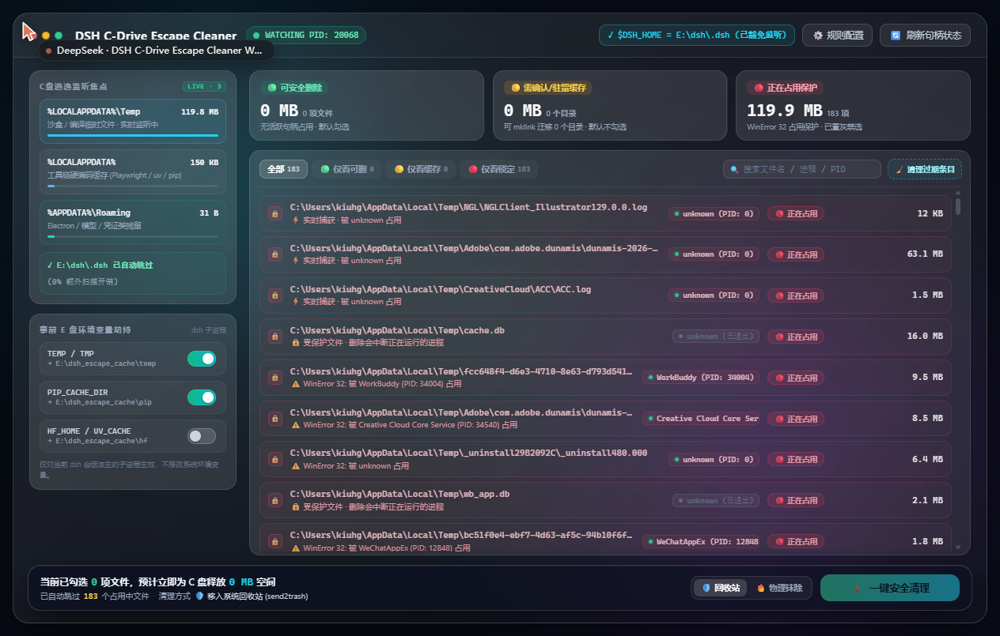

# dsh-c-cleaner

**简体中文** · [English](#english)

DeepSeek Harness 的 **C 盘逃逸监测与安全清理**插件：把 AI 工具链的缓存与临时文件拦在 C 盘之外，并安全回收已经逃逸出去的那部分。

以**原生 Cordis 宿主插件**实现（Node.js，除 Node 内置模块外零运行时依赖），实现了 `产品需求与技术规格文档 (PRD).md` 的全部 Phase 1 + Phase 2 + Phase 3 需求。

`0.5.0` · MIT · Node ≥ 20 · DSH ≥ 0.2.1-rc.2


> 实机截图：左侧是 Harness 侧边栏（「C 盘逃逸清理」高亮选中），右侧是它打开的玻璃面板 —— 统计卡、三级分类表、勾选与清理操作都在同一屏内完成。

---

## 它解决什么问题

PRD 的前提是「`$DSH_HOME` 已经在 E 盘，所以只剩下 C 盘的**逃逸**写入」。本插件分四层处理这个残留：

| 阶段 | PRD | 模块 | 状态 |
| --- | --- | --- | --- |
| 事前拦截 —— 环境变量劫持 | §3.1 | `lib/env-hijack.js` | 已实现，有实机证据 |
| 事中监控 —— C 盘写入监听 | §3.2 | `lib/watcher.js`、`lib/process-tree.js` | 已实现 |
| 三级分类 | §3.3 | `lib/classifier.js` | 已实现 |
| 事后清理 —— 安全删除 | §3.4 | `lib/cleaner.js` | 已实现 |
| 目录迁移 —— `mklink /J` 联接点 | §3.4 | `lib/symlink-migrate.js` | 已实现（Phase 3） |
| CLI/TUI —— `c-clean` 命令 | §4 | `lib/commands.js` + `lib/web-api.js` + `client.js` | `status`/`now`/`ui`/`migrate`/`unmigrate` 全部可用 |
| 持久化 —— SQLite 状态库 | §5 | `lib/state-db.js` | 已实现（`node:sqlite`） |
| 会话结束静默清理 —— `post_session_close` | §7 | `lib/session-hook.js` | 已实现（Phase 3，默认关闭） |

Phase 3 的两项交付物都已落地：

- **`mklink /J` 联接点迁移**（PRD §3.4/§7）——把一个顽固目录整体搬离 C 盘，并在原路径留下目录联接点，让写死路径的程序继续正常工作，而字节落在目标盘。支持撤销。
- **`post_session_close` 静默清理**（PRD §7）——会话结束时静默清扫 🟢 文件。宿主并没有这个事件名，钩子绑的是 `session/disposed`（详见下文「已知限制」第 8 条）。**默认关闭**（`sessionCloseClean: false`）。

`ui` 以 Harness **侧边栏面板**的形式交付，而不是终端 TUI —— 因为 Cordis 的斜杠命令无法渲染交互式组件。

## 安装

`dsh plugin` 是官方入口：它是 pnpm 的前端，在 profile 目录内执行，并在安装成功后为每个声明了 `dsh.bundle` 的新依赖自动改写 `dsh.profile.bundles`。本包声明了一个（`./cordis.patch.yml`），所以会被自动注册为一个生效的 profile 层 —— **不要**手改 profile 的 `package.json` 或 `cordis.patch.yml`，也**不要**在 `$DSH_HOME` 下创建包。

### 从本地目录安装（绝对路径）

```sh
dsh plugin --profile <profile> add <指向本目录的绝对路径>
# 例如：dsh plugin --profile tauri add F:/work/dsh-c-cleaner
```

相对目录同样可用，会按当前工作目录解析：

```sh
cd F:/work && dsh plugin --profile <profile> add ./dsh-c-cleaner
```

这两种形式都装成 **link 依赖**，所以之后在源码目录里的修改会立刻反映到磁盘上。

### 从 npm 安装（按包名）

```sh
dsh plugin --profile <profile> add dsh-c-cleaner
```

> 这一条只在包发布到 npm 之后可用。发布前请改用下面的 GitHub、tarball 或本地路径形式 —— 否则 pnpm 会以 `[ERR_PNPM_FETCH_404] GET https://registry.npmjs.org/dsh-c-cleaner: Not Found` 失败。

### 从 GitHub 安装

```sh
dsh plugin --profile <profile> add github:wuyu1327083461/dsh-c-cleaner
```

### 从打包的 tarball 安装

```sh
dsh plugin --profile <profile> add file:<dsh-c-cleaner-0.5.0.tgz 的绝对路径>
```

路径请用 Windows 风格（`file:C:/...`），不要用 MSYS 风格（`file:/c/...`）—— pnpm 不接受后者。

### 通过 `plugin_manager` 工具安装

同样的安装，由 agent 会话驱动而不是 shell：

```
plugin_manager { action: "install_bundle", target: "<指向本目录的绝对路径>" }
```

**替换**一个已安装的副本需要**重启** Harness 才能加载新的 JS 模块代际；首次安装可以通过 HMR 直接生效。

### `files` 字段里必须有什么

pnpm 会按照 `files` 数组来打包 git / tarball 依赖，所以 `cordis.patch.yml` **必须**列在其中。缺了它，装出来的树里没有 patch 文件，安装会被拒绝：

```
dsh: installation rejected: ... failed to read overlay ... cordis.patch.yml: ENOENT
```

随后整体回滚 `package.json`、`pnpm-lock.yaml` 和 `node_modules`。路径安装和 `link:` 安装不经过打包，因此不受影响 —— 这也正是这个疏漏能长期潜伏的原因。

## 使用

```
c-clean status                      # 只读汇总，不遍历磁盘
c-clean ui                          # 指向交互式面板（Harness 侧边栏）
c-clean now                         # 把所有 🟢 SAFE_TO_DELETE 清理进回收站
c-clean now --deep                  # 连同 🟡 CAUTION_CACHE 一起清理
c-clean now --force                 # 物理删除，不进回收站
c-clean now --deep --force
c-clean migrate                     # 列出值得搬离 C 盘的顽固目录
c-clean migrate <dir>               # 搬到 E 盘并留下目录联接点（PRD 3.4，mklink /J）
c-clean unmigrate <dir>             # 撤销迁移，把数据搬回 C 盘
```

`status` 的输出，首行即 PRD §4 的约定格式：

```
🟢 可清理: 342.0 MB (128个文件) | 🟡 缓存驻留: 1.2 GB | 🔴 正在占用: 3个文件
环境变量劫持: ✅ 已生效 (9/9 变量) → E:\dsh_escape_cache
```

## 交互式面板（PRD §4 的 `ui`）

斜杠命令无法渲染组件，所以 `c-clean ui` 返回一个指针加上实时摘要，真正的 UI 是 Harness 侧边栏里的 **Client-slot React 面板**。找侧边栏导轨上的 **C 盘逃逸清理** 图标：


面板是一个整页 `main` 槽位组件，数据来自宿主半侧的 JSON API：

| 端点 | 方法 | 返回 |
| --- | --- | --- |
| `/c-cleaner/api/state` | GET | `{rows, hijack, escapeRoot, useRecycleBin, escapeWritable}` |
| `/c-cleaner/api/refresh` | POST | 重新轮询进程树，然后返回**同样形状**的快照 |
| `/c-cleaner/api/clean` | POST | `{report, rejected, rows}` |
| `/c-cleaner/api/stale` | GET | `{count, bytes, scanned, kept}` —— 有多少条跟踪记录会被今天的准入规则拒绝 |
| `/c-cleaner/api/purge` | POST | 遗忘这些记录，然后 `{forgotten, bytes, remaining, rows}` |
| `/c-cleaner/api/migrate` | POST | `{path}` → 搬到 E 盘并留下联接点：`{result, migrated, rows, migrations}` |
| `/c-cleaner/api/unmigrate` | POST | `{path}` → 撤销一条已记录的迁移：`{result, migrated, rows, migrations}` |

`/state` 和 `/refresh` **故意**返回完全一致的快照形状。早先让 `/refresh` 只返回 `rows`，结果刷新之后顶栏立刻显示「环境变量劫持未生效」—— 在面板最关键的那行状态上误报了一次逃逸根目录。

### 遗忘准入规则之前的旧记录（`/stale` + `/purge`）

PRD §3.2 的噪声闸门（见下面「已知限制」第 1–2 条）只对**从今往后**监听器看到的写入生效。在那之前写入的记录会留在表里 —— 实机测量：**2205 条绿色记录中的 1079 条、约 1.09 GB**，绝大多数是 Windows SDK 安装包和属于其他软件的 Visual Studio DLL。它们删了并不危险（`%TEMP%` 里未加锁的文件），但「全选可清理项」/「清理全部可清理」会作用于**全部**绿色记录，一次点击就会把别的软件的安装包扫进回收站，同时把 PRD 真正要求展示的 dsh 记录埋在下面。

「清理过期条目」移除的正是这些记录，它**只做记账**：

- 复用监听器同一个 `classifyName()`，准入规则只有一份实现，不会漂移成两份；
- 只有 `SAFE_TO_DELETE` 记录可选 —— 无论名字长什么样，🔴 或 🟡 记录永不被遗忘；
- PRD §3.3 的凭证闸依然生效（`credentials.json` 不会被清掉）；
- **磁盘上没有任何文件被改动。** 实机验证：清除掉一个 84 MB 安装包的记录后，文件仍在原路径、大小不变。

`GET /stale` 只做计数，好让面板在用户确认之前先展示数量。

### API 为什么要设防

`/clean` **会删文件**，而 `127.0.0.1:3080` 可以被本机任意页面访问。所以每个请求都必须通过 `isTrustedApiRequest()`（`lib/web-api.js`）：`Host` 必须是回环地址（或在 `trustedHosts` 中）、直接拒绝 `sec-fetch-site: cross-site`，其余情况要求 `Origin` 的主机名等于 `Host` 的主机名（并显式放行桌面壳自己的源 `dsh-app://app`）。回环请求但带上外来 `Origin` 同样会被拒绝 —— 实机验证：

```
# 实机，打到运行中的 harness
curl -H 'Host: evil.example.com' http://127.0.0.1:3080/c-cleaner/api/state   -> 403
curl -X POST .../c-cleaner/api/clean  -d '{"paths":["C:\\Windows\\System32\\kernel32.dll"]}'
                                                                             -> rejected, deletedCount 0
```

第二条才是真正的护栏：**面板只能清理插件自己已经跟踪过的东西**。每个请求路径都会（大小写不敏感地）与持久化记录匹配，交给清理器的每条记录都**从持久化列重建** —— 客户端伪造 `{"category":"SAFE_TO_DELETE"}` 也无法把 🔴 文件提级。`test/_lead-phase2-api.mjs` 正是用伪造请求体来断言这一点。

面板自己的传输走页面的目录基准而不是源根路径（`client.js` 里的 `hostRouteUrl`），因为以斜杠开头的 URL 会把自己钉死在源根上，放在反向代理的子目录后面就会 404。桌面壳里面页是 `dsh-app://app/`，壳的协议处理器会把非模块路径同源转发给宿主。

### 玻璃面板（`/c-cleaner/ui`）

上面那个 React `main` 槽位面板是**两种**渲染之一，第二种才是值得一看的。`c-clean ui` 还会打开位于 `http://127.0.0.1:3080/c-cleaner/ui/index.html` 的**玻璃面板** —— 一个自包含文档（2650 行，零外部请求，无 CDN、无框架），由插件自己托管：



| 端点 | 方法 | 返回 |
| --- | --- | --- |
| `/c-cleaner/ui/api/get_state` | POST | 完整快照：环境变量分组、监听根、三级记录 |
| `/c-cleaner/ui/api/clean` | POST | 扁平的 `{ok, cleaned, skipped, freed_bytes}` |
| `/c-cleaner/ui/api/migrate` | POST | `{ok, target, bytes_moved}` —— 到 E 盘的联接点 |
| `/c-cleaner/ui/api/unmigrate` | POST | 撤销一条已记录的迁移 |
| `/c-cleaner/ui/api/poll_events` | POST | `{cursor, events}` —— ⚡实时捕获 通道 |

它被原样托管而不是改写成 React 组件，是因为一个 2500 行、已经充分验证过的界面手工移植过去，必然带来视觉漂移。`lib/panel-ui.js` 在**第二个前缀**（`/c-cleaner/ui`，最长前缀优先于既有的 `/c-cleaner/api`）上注册路由，并把它那套扁平方言翻译成本插件自己的 `{ok, value}` 信封与分类名 —— 文档本身一行都不用改，因为它自己的 `REST_BASE='api/'` 是相对路径，浏览器会相对文档所在目录解析。

玻璃面板有两个刻意的、承担关键职责的行为（`lib/panel-snapshot.js`）：

1. **🟡 记录按目录聚合。** `findCandidates` 按 `path.dirname` 分组，会把 `uv-cache/wheels/<1000 个 .whl>` 变成 1000 条各自都拒绝迁移的记录。面板改成按**监听根下的第一层目录**分组，于是一条 🟡 记录 == 一个可迁移目录。
2. **路径一律以 C 盘拼写显示，绝不经联接点解析。** 已迁移目录在 C 盘上就是一个指向 E 盘的重解析点；`realpath` 会打印 E 盘路径，从而抹掉这条记录唯一要传达的事实 ——「已经打通了，但仍占着它的 C 盘位置」。

实时通道是有界环形缓冲（`index.js` 中的 `LIVE_BUFFER_MAX = 500`），不是无限日志：面板只索取比上次游标**更新**的事件，长期空闲的会话不能让它无界增长。记录会在任何 `autoClean` 能删掉文件**之前**推进缓冲，所以即使文件下一秒就没了，面板仍会显示这次捕获。

## 环境变量劫持到底怎么生效（关键细节）

PRD 的前提是「`$DSH_HOME` 已经搬到 E 盘，所以只剩下 C 盘的逃逸写入」。3.1 模块就是用来掐断新增逃逸的。

在这个 harness 里给子进程喂环境变量有两条路，而其中只有一条能带上 `TEMP`/`PIP_CACHE_DIR`：

- `ctx.shellEnv.register()` 只贡献 **`DSH_*` 命名空间**的键（`dsh-subprocess/lib/index.js:13` → `const DSH_ENV_PREFIX = "DSH_"`），带不了 `TEMP`。
- 直接改 `process.env` 可以，因为每个 harness 子进程都是**实时**读取父环境来构造的：`dsh-subprocess/lib/index.js:50-56` 的 `scrubbedParentEnv()` 用 `Object.entries(process.env)` 构建子环境，只过滤匹配 `/KEY|PASSWORD|SECRET|TOKEN/i` 的名字，以及 `DSH_` 开头的名字。

所以插件只改 `process.env`，别的什么都不碰。已针对真实安装的 `scrubbedParentEnv` 验证，并带有反向对照：

```
=== 劫持之后 scrubbedParentEnv()（每个 harness 子进程继承到的环境）===
  PASS  TEMP                     = E:\dsh_escape_cache\temp
  PASS  PIP_CACHE_DIR            = E:\dsh_escape_cache\pip_cache_dir
  ... 9/9 个被劫持变量都扛过了 harness 的环境清洗
--- 反向对照（证明清洗逻辑确实在跑）---
  MY_FAKE_API_KEY present       : false（期望 false —— 命中 KEY）
  DSH_SHOULD_BE_STRIPPED present: false（期望 false —— DSH_ 前缀）
--- 端到端：真实子进程 ---
  child cmd.exe saw TEMP = E:\dsh_escape_cache\temp
```

用 `node test/_env-propagation.mjs` 复现。

被重定向的变量（`lib/config.js` → `DEFAULT_ENV_MAP`）：`TEMP`、`TMP`、`TMPDIR` → `temp`；`PIP_CACHE_DIR` → `pip`；`UV_CACHE_DIR` → `uv`；`HF_HOME` → `huggingface`；`TORCH_HOME` → `torch`；`NPM_CONFIG_CACHE` → `npm`；`PLAYWRIGHT_BROWSERS_PATH` → `playwright` —— 全部位于 `escapeRoot` 之下，而 `escapeRoot` 从 **`$DSH_HOME` 所在的盘**派生（`path.parse(dshHome).root`），所以 `DSH_HOME=E:\dsh\.dsh` 时逃逸根是 `E:\dsh_escape_cache`。没有任何地方硬编码 `E:`。

两个刻意保持的性质：

- **绝不改动操作系统环境。** 只改本进程的 `process.env`；不写注册表，也不写用户级/系统级环境块。
- **`restore()` 精确还原。** 原先不存在的变量在还原时会被**删除**，而不是设成字符串 `"undefined"`。旧值是被捕获下来的，不是硬编码的。赋值前会先过 `SCRUB_PATTERN`（`/KEY|PASSWORD|SECRET|TOKEN/i`），所以当用户把 `MY_API_KEY` 加进 `envMap` 时，它会带着原因被跳过，而不是悄悄被挪走。

## 三级分类（PRD 3.3）

| 级别 | 条件 | 默认 |
| --- | --- | --- |
| 🟢 `SAFE_TO_DELETE` | 未加锁**并且**（在 Temp 目录下**或**后缀为 `.tmp`/`.log`/`.pyc`/`.bak`**或**已知的一次性解压缓存） | 勾选 |
| 🟡 `CAUTION_CACHE` | 未加锁，且属于 AppData 工具链缓存 / 模型权重 / 浏览器内核 / 预编译 pkg | 不勾选 |
| 🔴 `LOCKED_CRITICAL` | 已加锁（WinError 32 / `PermissionError`）**或**名字长得像持久化文件（`.lock`、`.sqlite`、`.db`、`auth`、`config`、`token`） | 锁定，不可选 |

各条件之间是「与」的关系。锁检测探测的是文件**能否被真正删除**（`fs.renameSync(path, path)` → `EBUSY`/`EPERM` 表示已锁；`ENOENT` 表示未锁）。自我重命名需要的权限恰好就是删除权限，也就是真正要紧的那个操作。`openSync(path,'r+')` 是 Phase 1 的探测方式，实测证明它是错的：一个进程可以以读写共享打开文件但**不给**删除共享，于是 `r+` 在无法删除的文件上也会成功（见 `CONTRACTS.md` §8.1）。

对 🔴 文件，**谁占着它**随后通过 Windows 重启管理器（`lib/lock-owner.js`）带外解析，得到真实的持有者 PID 与进程名；显示的正是这个名字。这一步是异步且带缓存的，因为同步的 `classify()` 不可能为一次约 140 ms 的 PowerShell 往返而阻塞。见下面限制第 3 条。

## 安全属性

这些属性使自动删除站得住脚，每一条都有测试背书：

1. **硬编码的受保护路径黑名单**（PRD 6.2）—— `C:\Windows`、`C:\Program Files*`、桌面、文档。`clean()` 会施加**自己**的否决，独立于 `classify()` 的返回，所以分类逻辑的 bug 无法扩大删除集。已演示：`C:\Windows\Temp` 下被分类为 `SAFE_TO_DELETE` 的文件，仍会被 `clean()` 以 `protected path (PRD 6.2 hardcoded blacklist) — refused` 拒绝。
2. **即时复核** —— 每次 unlink 之前立刻重查锁状态。在分类与删除之间被锁上的文件会被跳过，而不是被删掉。
3. **`clean()` 从不抛异常** —— 文件消失、文件被锁、空记录集，或运行中间出现 `PermissionError`，都会变成一条报告项；整轮继续（PRD 6.3）。
4. **默认走回收站** —— 删除通过 `Microsoft.VisualBasic.FileIO.FileSystem.DeleteFile(..., RecycleOption.SendToRecycleBin)` 完成，每次调用批处理 ≤ 50 个路径。`--force` / `useRecycleBin: false` 才走物理删除。
5. **不递归扫 C 盘**（PRD 6.1）—— `fs.watch({recursive:true})` **仅**允许在 `%LOCALAPPDATA%\Temp` 之下使用。监听器会拒绝在盘根、`%USERPROFILE%`、`C:\Users`、`C:\Windows*`、`C:\Program Files*`、`C:\ProgramData` 上递归，并把拒绝记录在 `stats().recursiveForcedOff` 里。

## 配置

每个字段都是可选的，都有默认值。写在 bundle 行的 `config` 里：

```yaml
- insert:
    - id: dsh-c-cleaner
      name: 'dsh-c-cleaner'
      config:
        debounceMs: 3000
        useRecycleBin: true
```

| 键 | 默认值 | 含义 |
| --- | --- | --- |
| `enabled` | `true` | 总开关 |
| `dshHome` | `$DSH_HOME` | 逃逸根所在的盘由它派生 |
| `escapeRoot` | `<dshHome 所在盘>:\dsh_escape_cache` | 劫持目标目录 |
| `stateDir` | `$DSH_HOME/plugins/c_cleaner` | 状态目录 |
| `dbPath` | `<stateDir>/state.db` | SQLite 文件 |
| `envMap` | 见上 | 变量 → 子目录 |
| `watchDirs` | `%LOCALAPPDATA%\Temp`（递归）、AppData Local + Roaming（深度 1） | 监听根 |
| `protectRoots` | `C:\Windows`、`C:\Program Files*`、桌面、文档 | 永不删除 |
| `excludeNames` | `[".dsh"]` | 排除的路径段（`.dsh` 自身永不被监听） |
| `aiSignatureGlobs` | AI 工具链名字模式 | 会话窗口归属判定 |
| `debounceMs` | `3000` | 合并流式写入 |
| `pollIntervalMs` | `5000` | 进程树轮询间隔 |
| `sessionWindowMs` | `1800000` | 会话窗口 |
| `useRecycleBin` | `true` | 回收站 vs 物理删除 |
| `maxBatch` | `50` | 每次回收站调用的路径数 |
| `resolveLockOwner` | `true` | 通过 Windows 重启管理器解析 🔴 文件的持有者 PID（PRD 3.3） |
| `noiseGate` | `'enforce'` | PRD §3.2 准入：`enforce` 丢弃未准入文件，`audit` 只计数但照旧记录，`off` 是 Phase 1 的直通 |
| `admitCriticalNames` | `true` | §3.3 的安全阀：名字像凭证的文件永不被噪声过滤掉 |
| `handleIndex` | `false` | ⚠️ psutil 句柄→PID 索引（规则 #1）。实测每次扫描约 2 s CPU —— 见限制 1 |
| `handleSweepMs` | `60000` | 句柄索引扫描间隔（最小 15000） |
| `pythonPath` | `null` | 句柄索引使用的 python 解释器；`null` 从 PATH 解析 `python` |
| `recoverClientGraph` | `true` | 重建过期的 `dsh.client` 缓存项，使面板无需重启即可加载 |
| `autoClean` | `false` | **Phase 3 起废弃** —— 监听器看到 🟢 记录就逐条自动清理。已被 `sessionCloseClean` 取代，仅为兼容保留 |
| `sessionCloseClean` | `false` | ⚠️ PRD Phase 3 的 `post_session_close`：会话关闭时静默清理 🟢 记录 |
| `sessionCloseMinAgeMs` | `60000` | 比这更年轻的会话不被清扫（宿主会不断销毁临时会话） |
| `migrateTargetRoot` | `null` | 联接点迁移目标；`null` 时派生为 `<escapeRoot>\migrated` |
| `migrateVerify` | `true` | 跨卷复制后重新测量两侧目录树，再删源 |
| `migrateMinBytes` | `10485760` | 小于此总量的目录不提供迁移 |

配置由**手写的 Standard Schema**（`lib/config-schema.js`）校验。Cordis 只要求 `{ '~standard': { version, vendor, validate } }`（`cordis/lib/index.js:956-962`），直接实现它可以避免静态 import `schemastery` —— 后者要从 `$DSH_PROFILE_DIR/node_modules` 解析，一个解析失败的插件会**整体**加载失败，对一个可选的便利功能来说代价太高。

## 目录结构

```
index.js                  plugin entry: apply(ctx, config), wiring + teardown
lib/config.js             resolveConfig, DEFAULT_ENV_MAP, formatBytes
lib/config-schema.js      Standard Schema `Config`
lib/env-hijack.js         EnvHijacker: install / status / restore
lib/process-tree.js       ProcessTree: dsh child-PID set via Win32_Process
lib/watcher.js            CWatcher: fs.watch + debounce + AI-signature filter
lib/classifier.js         isLocked / isProtectedPath / classify
lib/cleaner.js            toRecycleBin / hardDelete / clean (never throws)
lib/lock-owner.js         LockOwnerResolver: Restart Manager → holder PID + name (PRD 3.3)
lib/state-db.js           StateDB over node:sqlite (+ migrations journal)
lib/symlink-migrate.js    Phase 3: inspectDirectory / migrateDirectory / undoMigration / junction
lib/session-hook.js       Phase 3: post_session_close -> `session/disposed` silent clean
lib/commands.js           registerCommands: c-clean status|ui|now|migrate|unmigrate
lib/panel-snapshot.js     tracked_files rows -> the panel's TrackedFileItem[] (CAUTION dir aggregation)
lib/panel-ui.js           serves ui/index.html at /c-cleaner/ui and adapts its REST dialect
ui/index.html             the glass panel document (self-contained, no external requests)
test/run.js               dependency-free acceptance + adversarial harness
test/_env-propagation.mjs proves the hijack reaches real children
CONTRACTS.md              frozen interface contract the modules were built against
CONTRACTS-PHASE2.md       Phase 2 frozen contract (noise gate + handle index)
CONTRACTS-PHASE3.md       Phase 3 frozen contract (junction migration + session-close hook)
docs/panel.png            面板嵌在 Harness 侧边栏里的截图
docs/glass-panel.png      玻璃面板单独打开的截图
```

## 已知限制

逐条写明，因为每一条都界定了本插件能承诺的范围：

1. **除非打开句柄索引，否则 `ProcessTree.ownerOf()` 返回 `null`。** Node 在 Windows 上没有廉价的句柄→PID 映射，所以 PRD §3.2 规则 #1 由 `lib/handle-index.js` 承担 —— 一个**可选**的 psutil 驱动索引。它默认关闭，因为对一个 11 进程的树做一次句柄扫描实测要 **约 2.0 s CPU**（psutil 的 `open_files()` 对每个进程都要重新遍历系统句柄表），按 60 s 间隔已经是一个核心的 ≈3.4 % —— 超过 PRD 自己规定的 ≤2 % 边际 CPU 预算（PRD §6.1）。它从不编造 PID、每次扫描都缓存，并在超预算时自动关闭。默认 `handleIndex: false` 的实际后果是：**是规则 #2（会话窗口 + AI 工具链签名）在填充候选集**，外加下面的 §3.3 凭证闸。
2. **噪声闸门带有刻意的 PRD §3.3 安全阀。** PRD §3.2 说只记录可归因于 dsh 或命中 AI 签名的文件 —— 但 PRD §3.3 要求 `%TEMP%` 里名字像凭证的文件必须以 🔴 `LOCKED_CRITICAL` 连同持有者一起出现。`credentials.json` 不匹配任何 AI 工具链签名，所以严格的签名闸门会把 §3.3 恰恰要求展示的东西悄悄过滤掉。因此 `admitCriticalNames`（默认 `true`）总是放行匹配 `\.lock$|\.sqlite3?$|\.db$|auth|config|token|credential` 的文件名。实机在同一目录同一秒验证：`Win11SDK_*.msi` → 被过滤；`pip-*.log` → 🟢 被跟踪；`credentials.json` → 🔴 被跟踪。设 `noiseGate: audit` 可只计数不丢弃，`off` 走旧直通。
3. **谁占着被锁文件，走的是另一条路：Windows 重启管理器**（`lib/lock-owner.js`，PRD §3.3）。`classify()` 是同步的，不可能为一次约 140 ms 的 PowerShell 往返而等待，所以 `locked_by_pid` 是在记录持久化**之后**回填的。因为 PRD §5 的 DDL 是固定的、没有持有者名字段，持有者进程名搭在 `source_process` 列上，且仅在尚无更好的值占据该列时。批量（每 250 ms 窗口一次 spawn）、带缓存（命中 30 s，未命中 5 s）、且只对真正被锁的记录触发 —— 罕见事件 —— 所以 PRD §6.1 的预算在结构上不受影响。设 `resolveLockOwner: false` 可关闭。实际后果：**未加锁**文件的 `source_process` 保持 `null`；只有 🔴 记录会获得持有者名字。
4. **归属是尽力而为的**，所以 dsh 会话期间有外部进程往 `%TEMP%` 写，可能被错误归属。`%TEMP%` 是共享目录；AI 签名过滤缩小了这个残差但没有消除它。正因如此，默认动作才是只把 🟢 项送入回收站。

   **诚实地说，残差很大。** 规则 #2 是**名字形状**启发式，而 PRD 自己给出的示意签名列表（`tmp*`、`*.log`、`*.tmp`、`*.pyc`……）在 Windows 上很弱 —— 这些形状是操作系统和其他厂商不断产出的东西。按「该模式是否指向某个 AI 工具链」给被跟踪集合分桶（`test/_lead-p2-noise-composition.mjs`）：

   | 桶 | 记录数 | 占比 |
   | --- | --- | --- |
   | A —— 工具链专属（`pip-*`、`torch*`、`hf-*`、`node-*`、`*-cache`） | 431 | 24.2 % |
   | B —— 仅通用扩展名（`*.tmp`、`*.log`……） | 778 | 43.7 % |
   | C —— PRD §3.3 凭证闸 | 539 | 30.3 % |
   | D —— 无任何签名（闸门之前的遗留） | 32 | 1.8 % |

   桶 B 的真实样本是**其他软件**的文件：BITS 的 `BIT450E.tmp`（Edge）、`dd_BackgroundDownload_*.log`、Adobe 的 `dunamis-*.log`、Visual Studio 的 `tmp.edb`。所以闸门能可靠地剔除大二进制形状（`.msi`、`.dll`、`.exe` —— 真正占盘的东西），但**并不会**把 `%TEMP%` 的产出收窄到只剩 dsh 写的文件。要真正补上这个缺口，需要规则 #1（句柄反查，被 §6.1 的 CPU 预算推成了可选项 `handleIndex`），或把 `aiSignatureGlobs` 收窄到工具链专属模式 —— 例如去掉 `tmp*`/`*.log` —— 那是用召回换精度的一行配置改动。
5. **保护路径做了规范化，但没有哪种规范化是完美的。** `isProtectedPath()` 现在会解析 `\\?\`/`\\.\` 设备前缀、UNC 与管理共享拼写、重复分隔符、每个路径段末尾的点和空格、8.3 短名（`C:\PROGRA~1`）、联接点/重解析点，并做大小写不敏感比较 —— 而且删除时的检查会**重新**解析，而不是信任分类时的缓存。这关闭了对抗测试发现的四个真实 PRD §6.2 绕过（见 `test/run.js` 的 A1/A6/A9/A10 探针）。但它仍然是一份「已知良好规范化形式」的黑名单，不是证明；还没人想到的文件系统写法不在覆盖范围内。
6. **`ui`（PRD §4）以 Harness 面板交付，不是终端 TUI。** PRD 要求的是带热键的 Textual 风格终端面板；Cordis 的斜杠命令无法渲染交互式组件，所以面板是 Harness 侧边栏里的 Client-slot React 页面，`c-clean ui` 返回指向它的指针。PRD 的热键在面板内部得到保留（`Space` 切换勾选、`Enter` 清理所选、`M` 把所选目录迁移到 E 盘、`R` 刷新）。
7. **迁移是移动，不是复制 —— 而且 PRD 的 `mklink /J` 不经 shell 完成。** PRD 点名 `mklink /J`；调用它意味着用 `cmd.exe` 拼接用户可控的带引号路径，这是经典的注入面。`fs.symlinkSync(target, link, 'junction')` 生成的**是同一个** NTFS 联接点，无需 shell、无需管理员权限（由探针 `P3` 钉住）。跨卷 `fs.renameSync` 在 Windows 上不可能（实测 `EXDEV`），所以移动是 `cpSync` → 独立重新测量两侧目录树 → `rmSync` 源；账目不匹配就删掉半成品副本并保持源不动。日志行让被中断的迁移可恢复而不是丢数据。目录内有文件被打开时会在复制**之前**直接拒绝：`inspectDirectory` 探测每个文件并回答 `FILES_IN_USE`（并给出持有者），因为 `rmSync` 删不掉一个未给删除共享的文件，却会先把能删的删掉。关掉占用程序再重试。
8. **Phase 3 的 `post_session_close` 是个名字，不是一个事件。** `@deepseek-ai/*` 里根本不存在这个标识符；真正的接缝是 Cordis 的 **`session/disposed`**（`@deepseek-ai/dsh-session/lib/index.js:1813-1821`，从第 1780 行的 `detachEntered` 到达），也是 `dsh-session-telemetry`、`dsh-session-persistence-jsonl`、`dsh-session-projection-cache` 订阅的同一个事件。钩子把 PRD 的名字保留在配置键里，好让需求可追溯。它是**排在 `clean()` 前面的调度器**，不是第二条删除路径：§6.2 / 目录 / 重解析点的每一项拒绝在删除时依然生效。
9. **面板是进程启动时从清单里发现的。** `@deepseek-ai/dsh-client-modules`（`lib/index.js:510,703,707,715,729` —— `grep -n pkgMeta` 找不到删除操作）只在那一刻读清单，所以一个在 harness 启动**之后**才获得 Client 半侧的插件，会一直缺席浏览器的启动图，直到重启。`lib/client-graph.js` 在进程内从磁盘清单重建那一条缓存项，并请注册表重新处理本插件自己的 loader 行，这就是面板无需重启即可出现的原因。它有特性探测，任何疑问下都空转；设 `recoverClientGraph: false` 可关闭。
10. **插件只重定向它认识的变量。** 一个不认这九个变量中的任何一个（或硬编码了 C 盘路径）的工具链仍然会逃逸；那部分残留正是模块 3.2–3.4 存在的理由。
11. **由早于原始句柄注册表的模块代际武装的监听器，无法在进程内回收 —— 必须重启 harness。** 在运行中的 harness 下编辑 `lib/` 会热重载模块（HMR 层把这个目录当模块根监听），但 Cordis 并不总会在新代际启动前释放被取代的那一代。在本机用模块初始化/`start()` 标记实测：`START live=1 … START live=2` 而**没有任何配对的 `STOP`**，即两代监听器共存，且旧的那代继续按**旧**闸门规则写记录。现在有三道保护让 `apply()` 可重入安全：一个进程全局 `Symbol.for('dsh-c-cleaner.active-generation')` 槽位保存上一代的 disposer（模块级绑定不行，因为 HMR 会重新 import 模块体，每代都拿到新的空变量）；一个 `Symbol.for('dsh-c-cleaner.live-watchers')` 登记表，新代际会强制停掉其中的活 `CWatcher`；以及一个 `Symbol.for('dsh-c-cleaner.raw-watchers')` 登记表，记录**原始 `fs.FSWatcher` 句柄**，新代际直接关闭它们。真正治好泄漏的是原始登记表：`_getActiveHandles()` 返回 `[]`，`getActiveResourcesInfo()` 也点不出本插件那套 watch 选项（`{recursive:false, persistent:false}` + `unref()`）对应的 `FSEventWrap`，所以没人登记过的句柄根本无法被发现 —— 这是用一个在完整句柄扫描之后仍能投递（`delivered after scan-close: 2`）的泄漏监听器测出来的。**后果：**在原始登记表存在**之前**泄漏过句柄的代际，三道保护都够不着它，所以它的记录会一直冒出来直到 harness 重启。损害是有界的：`test/_lead-p2-gate-residue.mjs` 把每条持久化记录按出厂闸门重新分类，报告**0 条可删记录被闸门拒绝**（全部残留在灰色 🔴/🟡 层，永远不会被删），所以这是一个准确性缺陷，而不是删除风险。
12. **由早于认领槽位的模块代际注册的路由，必须按路径回收，因为 harness 的路由表只按路径删除。** 实机实测：一次 HMR 重载之后，面板对**每个**动词都回答 `500 {"code":"internal","message":"database is not open"}`。原因：更早的一代仍然占着 `/c-cleaner/api`，于是新一代的 `webServer.register` 抛出 `webserver: duplicate prefix route "/c-cleaner/api"`，这个异常被吞掉了，所有请求继续打到**死掉的**那一代处理器上，而它捕获的 `StateDB` 早已被自己的 teardown 关闭。两道保护修好了它。(a) 路由的 disposer 停放在进程全局 `Symbol.for('dsh-c-cleaner.web-api-route')` 认领槽里，每次 dispose 都做**归属校验** —— `register` 返回的是 `() => table.delete(route.path)`，它按**路径**而不是按身份删除，所以被取代的代际在 teardown 里无条件 dispose 会删掉**新**代际的路由、把 404 重新造出来。(b) `registerWebApi` 在注册之前直接从服务的 prefix 表（`WebServer.prefixes`，一个普通 `Map`）里回收自己的前缀，这才是治好「早于槽位的幽灵」的东西。只删除本插件自己的路径。探针：`test/_lead-p2-coldboot-route.mjs` 植入一个幽灵处理器，断言活着的代际替换它并回答 200（由 `test/_lead-p2-coldboot-route-mutation.mjs` 的 4 处变异证明）。

## 验证

```
node test/run.js                 # 验收 + 对抗性测试台（回归底线）
node test/_env-propagation.mjs   # 证明劫持真的传到了真实子进程
node test/_wire.mjs              # apply() 接线与 teardown（对 mock ctx）
node test/_perf-cpu.mjs          # PRD 6.1 CPU，隔离于 harness I/O
node test/_perf.mjs              # PRD 6.1 RSS + 递归保护

# Phase 2
node test/_lead-phase2-api.mjs      # API 护栏、路径/分类伪造拒绝、ui 动词文法
node test/_lead-phase2-client.mjs   # Client 半侧：槽位、分级、语言包释放、无 HTML 注入
node test/_lead-p2-config.mjs       # 新增配置键 + 失败即关闭的保护
node test/_lead-p2-purge.mjs        # /stale + /purge：只遗忘今天会被闸门拒绝的东西
node test/_dev-noise-gate.mjs       # PRD 3.2 准入判定，三种模式全覆盖
node test/_lead-p2-regex-design.mjs # 分级/闸门谓词拆分，含 TIGHT ⊆ LOOSE 的属性测试
node test/_lead-p2-valve-fix.mjs    # §3.3 安全阀放行凭证、拒绝安装包
node test/_lead-p2-reentry.mjs      # apply() 跨 HMR 代际可重入安全
node test/_lead-p2-reentry-mutation.mjs  # ……且该探针经变异验证
node test/_lead-p2-phantom-reap.mjs # 泄漏的原始句柄可被找到并关闭
node test/_lead-p2-gate-residue.mjs # 只读：没有任何可删记录被闸门拒绝
node test/_lead-p2-adversarial-final.mjs           # 最后一轮：谓词拆分、原始登记表、环境还原竞态
node test/_lead-p2-adversarial-final-mutation.mjs  # ……且该探针经变异验证（4 处变异）
node test/_lead-p2-coldboot-route.mjs              # 冷启动 + 幽灵路由回收（那个实测的 500）
node test/_lead-p2-coldboot-route-mutation.mjs     # ……且该探针经变异验证（4 处变异）
python test/_lead-p2-e2e-clean.py "<windows path>"   # 端到端驱动活着的面板 API
python test/_lead-p2-valve-live.py                   # PRD 3.3 安全阀，与噪声同一秒实机验证
python test/_lead-p2-tree-probe.py  <pid> 3          # psutil 进程树 + 句柄扫描开销

# Phase 3
node test/_lead-p3-db.mjs            # 迁移日志：幂等迁移、PENDING→MOVED→LINKED、取代
node test/_lead-p3-migrate-live.mjs  # 实机 C:→E: 迁移 + 撤销，走真实文件系统
node test/_lead-p3-refusals.mjs      # 迁移闸门：21 个拒绝码，保护判定先于 I/O
node test/_lead-p3-session-hook.mjs  # 会话关闭钩子：武装、最小年龄、冷却、错误遏制
node test/_lead-p3-grammar.mjs       # `migrate` / `unmigrate` 参数文法
node test/_lead-p3-locale.mjs        # 两份词典覆盖面板渲染的每个键（含 `[M]`）
node test/_lead-p3-verbs-live.mjs    # `migrate`/`unmigrate` 动词，实机，含 C:\Windows 被拒
node test/_lead-p3-api-live.mjs      # 真实 HTTP 上的 /migrate + /unmigrate，含护栏
node test/_lead-p3-busy-refusal.mjs  # 被打开的目录在复制前被拒绝，数据完好
node test/_lead-p3-clean-e2e.mjs     # POST /clean 端到端：文件真的被删，死记录被丢弃
node test/_lead-p3-user-report.mjs   # 复现用户报告的 EPERM 目录；现在是一条具名拒绝
python test/_lead-p2-cpu.py         <pid> 3          # 同一次扫描，CPU vs wall（§6.1 的那个数）

# 独立验证者的对抗轮
node test/adversarial-p2-api.mjs
node test/adversarial-p2-client.mjs
node test/adversarial-p2-gate.mjs
node test/adversarial-p2-purge.mjs
node test/adversarial-p2-purge-strict.mjs
node test/adversarial-p2-purge-rule1.mjs
node test/adversarial-p2-stalecount.mjs
node test/adversarial-p2-handle.mjs   # 会拉起真实 psutil 扫描：>120 s
```

### 本机实测记录

通过 `plugin_manager { action: "install_bundle", target: "F:\\work\\dsh-c-cleaner" }` 安装
→ `{"changed":true,"application":"applied","warnings":[]}`。

0.5.0 的清单修正之后，又通过 `dsh plugin` CLI 重装了一遍，一个临时 profile 和本机正在跑的 `tauri` profile 都装过：

```
$ node <DSH_BIN> plugin --profile <p> add F:/work/dsh-c-cleaner
dependencies:
+ dsh-c-cleaner link:F:/work/dsh-c-cleaner
Done in 347ms using pnpm v11.7.0
# 之后的 profile package.json：
#   "dependencies": { "dsh-c-cleaner": "link:F:/work/dsh-c-cleaner" }
#   "dsh.profile.bundles": ["dsh-c-cleaner"]        <-- 由 reconcile() 注册
```

`dsh --profile tauri --dump-config` 随后把 overlay 组合为 `# == dsh-c-cleaner` / `id: dsh-c-cleaner` / `name: dsh-c-cleaner`，且 `evaluatePluginCompatibility(manifest)` 对运行时 `0.2.1-rc.2` 报告无问题。

**（a）劫持确实到达真实子进程。** 安装后的一次普通 harness `bash` 调用：

```
$ node -e "console.log(process.env.TEMP, '|', process.env.PIP_CACHE_DIR)"
E:\dsh_escape_cache\temp | E:\dsh_escape_cache\pip

$ cmd //c "echo TEMP=%TEMP%"
TEMP=E:\dsh_escape_cache\temp
```

Git Bash 对 `$TEMP` 打印 `/tmp`，看起来像失败但不是：MSYS 把 `/tmp` **别名**到 `$TEMP`，`cd /tmp && pwd -W` 报告的是 `E:/dsh_escape_cache/temp`。原生 `cmd` 和原生 `node` 运行时都确认了被重定向的值。`E:\dsh_escape_cache\` 现在包含 `temp/ pip/ uv/ huggingface/ torch/ npm/ playwright/`。

**（b）监听器把真实的 C 盘写入记录进 SQLite。** 往**真实**的 C 盘 `%TEMP%` 写一个文件（`C:\Users\kiuhg\AppData\Local\Temp\lead-live-proof-1837.tmp`），等过防抖窗口后，在活的 `state.db` 里得到：

```
{"file_path":"C:\\Users\\kiuhg\\AppData\\Local\\Temp\\lead-live-proof-1837.tmp",
 "category":"SAFE_TO_DELETE","file_size":10,"is_locked":0}
```

**（c）schema 就是 PRD §5 的 schema**，由运行中的插件在 `E:\dsh\.dsh\plugins\c_cleaner\state.db` 创建：`CREATE TABLE tracked_files (...)` 带全部九个 PRD 列，加上 `idx_tracked_files_category` 和 `idx_tracked_files_checked`。唯一的偏差是 `CREATE TABLE IF NOT EXISTS`，这是 `migrate()` 幂等所必需的。

**（d）PRD §6.1 达标。** 同一个 10 秒、约 92 个文件的写入负载跑两遍 —— 一遍不挂监听器，一遍挂上 —— 得到插件的边际开销：

```
baseline : 10028ms, cpu 63.0ms => 0.63%
watcher  : 10025ms, cpu 156.0ms => 1.56%
PLUGIN MARGINAL CPU : 93.0ms over 10025ms = 0.93 %   (PRD <= 2%) -> PASS
RSS delta (plugin)  : 2.7 MB                          (PRD <= 30MB) -> PASS
```

朴素测法（整个进程，包含 harness 自己的 `fs.writeFileSync` 调用）读到 2.65%，看起来像失败；插件自己的份额是 0.93%。递归保护同样拒绝了在 `C:\` 和 `C:\Users\kiuhg` 上的 `recursive:true` —— `recursiveForcedOff: 2`。

### 测试台的两个坑

插件一旦安装就**运行在 harness 进程里**，所以它的劫持在任何测试开始之前就已经生效。一个断言 `process.env.TEMP !== <环境原值>` 的测试会因此伪失败。要在构造 hijacker **之前**为 `TEMP`/`TMP`/`TMPDIR` 设一个哨兵值，才能独立于安装状态测试真正的性质。

与此相关，插件活着之后 `os.tmpdir()` 返回的是**被劫持后的**逃逸根。用 `os.tmpdir()` 创建测试夹具，等于写进 `protectRoot`，监听器会正确地拒绝产出 —— 于是这样的测试测的是保护，不是监听器。要被**观察到**的夹具必须建在真实的 C 盘 `%TEMP%` 下。

### 在 harness 运行时编辑插件

已安装的包是指向本工作目录的**符号链接**（`$DSH_PROFILE_DIR/node_modules/dsh-c-cleaner -> F:/work/dsh-c-cleaner`），所以改动会立刻反映在磁盘上 —— 但运行中的 harness 继续用着它已经 import 的那一代模块。这在**本机实测**过，不是假设：用一个真实的 `FileShare.None` 句柄占住文件（正向对照：`openSync(p,'r+')` 抛出 `EBUSY`），活的监听器把记录持久化成 `LOCKED_CRITICAL`、`is_locked=1`，却让 `locked_by_pid`/`source_process` 保持 **null** —— 也就是运行中的进程仍在执行改动前的 `index.js`，那一版还没接线 `LockOwnerResolver`。同一个文件在现有模块下会解析出持有者。

harness 自带的 HMR **模块根是空的**（`@deepseek-ai/dsh-base/cordis.patch.yml` 里 `@deepseek-ai/dsh-hmr` 的 `config.root: []`）—— profile **配置**会热重载，模块**代码**不会。所以：**改完 `lib/` 或 `index.js` 之后要重启 harness**，改动才会在活进程里生效。首次全新安装仍可通过 HMR 直接激活，因为没有旧的代际需要替换。

## 许可证

MIT，见 [LICENSE](LICENSE)。

---

<a id="english"></a>

# dsh-c-cleaner (English)

[简体中文](#dsh-c-cleaner) · **English**

A **C-drive escape monitor and safe cleaner** for DeepSeek Harness: it keeps AI-toolchain caches and temp files off the C: drive, and reclaims the part that has already escaped.

Implements `产品需求与技术规格文档 (PRD).md` as a **native Cordis host plugin** (Node.js, zero runtime dependencies beyond Node built-ins), covering the PRD's Phase 1 + Phase 2 + Phase 3.

`0.5.0` · MIT · Node ≥ 20 · DSH ≥ 0.2.1-rc.2


> Captured live: the Harness sidebar on the left with "C 盘逃逸清理" selected, and the glass panel it opened on the right — stat cards, the three-tier table, selection and the clean actions all on one screen.

---

## What it solves

The PRD's premise is "`$DSH_HOME` already moved to E:, so only C-drive *escape* writes remain". This plugin handles that residue in four layers:

| Stage | PRD | Module | Status |
| --- | --- | --- | --- |
| Pre-emptive — environment hijack | §3.1 | `lib/env-hijack.js` | implemented, live-proof captured |
| Live watch — C-drive writes | §3.2 | `lib/watcher.js`, `lib/process-tree.js` | implemented |
| Three-tier classification | §3.3 | `lib/classifier.js` | implemented |
| Cleanup — safe deletion | §3.4 | `lib/cleaner.js` | implemented |
| Directory migration — `mklink /J` junction | §3.4 | `lib/symlink-migrate.js` | implemented (Phase 3) |
| CLI/TUI — the `c-clean` command | §4 | `lib/commands.js` + `lib/web-api.js` + `client.js` | `status`, `now`, `ui`, `migrate`, `unmigrate` all implemented |
| Persistence — SQLite state | §5 | `lib/state-db.js` | implemented (`node:sqlite`) |
| Silent clean on session close — `post_session_close` | §7 | `lib/session-hook.js` | implemented (Phase 3, opt-in) |

Both Phase 3 deliverables are in:

- **`mklink /J` junction migration** (PRD §3.4/§7) — move a stubborn directory off C: wholesale, then leave a directory junction at the original path so programs that hardcode it keep working while their bytes land on the target volume. Undo is supported.
- **`post_session_close` silent clean** (PRD §7) — a session-close hook that quietly sweeps 🟢 files. The host has no event by that name; the hook binds `session/disposed` (see *Known limitations* #8). It is **off by default** (`sessionCloseClean: false`).

`ui` is delivered as a Harness **sidebar panel** rather than a terminal TUI, because a Cordis slash command cannot render an interactive component.

## Install

`dsh plugin` is the official entry point: it is a pnpm front end that runs inside the profile directory and, after a successful install, rewrites `dsh.profile.bundles` for every new dependency that declares `dsh.bundle`. This package declares one (`./cordis.patch.yml`), so it becomes a live profile layer automatically — never hand-edit the profile's `package.json` or `cordis.patch.yml`, and never create packages under `$DSH_HOME`.

### From a workspace checkout (absolute path)

```sh
dsh plugin --profile <profile> add <abs path to this directory>
# e.g. dsh plugin --profile tauri add F:/work/dsh-c-cleaner
```

A relative directory works too, interpreted from the current working directory:

```sh
cd F:/work && dsh plugin --profile <profile> add ./dsh-c-cleaner
```

Both forms install a **link** dependency, so later edits in the checkout are visible on disk.

### From npm (by name)

```sh
dsh plugin --profile <profile> add dsh-c-cleaner
```

> This form only works once the package is published to npm. Until then use GitHub, the tarball, or a local path below — otherwise pnpm fails with `[ERR_PNPM_FETCH_404] GET https://registry.npmjs.org/dsh-c-cleaner: Not Found`.

### From GitHub

```sh
dsh plugin --profile <profile> add github:wuyu1327083461/dsh-c-cleaner
```

### From a packed tarball

```sh
dsh plugin --profile <profile> add file:<abs path to dsh-c-cleaner-0.5.0.tgz>
```

Use a Windows-style path (`file:C:/...`), not an MSYS path (`file:/c/...`) — pnpm does not accept the latter.

### Through the `plugin_manager` tool

The same install, driven from an agent session rather than a shell:

```
plugin_manager { action: "install_bundle", target: "<abs path to this directory>" }
```

Replacing an already-installed copy of this package requires a harness **restart** to load a fresh JS module generation; a first-time install can activate via HMR.

### What `files` must contain

pnpm packs a git or tarball dependency according to the `files` array, so `cordis.patch.yml` **must** be listed there. If it is missing, the installed tree has no patch file and the install is rejected with:

```
dsh: installation rejected: ... failed to read overlay ... cordis.patch.yml: ENOENT
```

after which `package.json`, `pnpm-lock.yaml` and `node_modules` are rolled back. Path and `link:` installs bypass packing and are unaffected, which is why the omission can hide for a long time.

## Usage

```
c-clean status                      # read-only summary, no disk walk
c-clean ui                          # points at the interactive panel (Harness sidebar)
c-clean now                         # clean all 🟢 SAFE_TO_DELETE to the recycle bin
c-clean now --deep                  # also clean 🟡 CAUTION_CACHE
c-clean now --force                 # physical delete instead of the recycle bin
c-clean now --deep --force
c-clean migrate                     # list the stubborn directories worth moving off C:
c-clean migrate <dir>               # move it to E: and leave a directory junction (PRD 3.4, mklink /J)
c-clean unmigrate <dir>             # reverse a migration, moving the data back onto C:
```

`status` output, first line is the PRD §4 contract format:

```
🟢 可清理: 342.0 MB (128个文件) | 🟡 缓存驻留: 1.2 GB | 🔴 正在占用: 3个文件
环境变量劫持: ✅ 已生效 (9/9 变量) → E:\dsh_escape_cache
```

## The interactive panel (PRD §4 `ui`)

A slash command cannot render a component, so `c-clean ui` returns a pointer plus the live headline, and the actual UI is a **Client-slot React panel** in the Harness sidebar. Look for the **C 盘逃逸清理** icon in the sidebar rail:


The panel is a full-page `main`-slot component fed by a fenced JSON API on the Host half:

| Endpoint | Method | Returns |
| --- | --- | --- |
| `/c-cleaner/api/state` | GET | `{rows, hijack, escapeRoot, useRecycleBin, escapeWritable}` |
| `/c-cleaner/api/refresh` | POST | re-polls the process tree, then the **same** snapshot shape |
| `/c-cleaner/api/clean` | POST | `{report, rejected, rows}` |
| `/c-cleaner/api/stale` | GET | `{count, bytes, scanned, kept}` — how many tracked rows today's gate would reject |
| `/c-cleaner/api/purge` | POST | forgets those rows, then `{forgotten, bytes, remaining, rows}` |
| `/c-cleaner/api/migrate` | POST | `{path}` → moves it to E: and leaves a junction: `{result, migrated, rows, migrations}` |
| `/c-cleaner/api/unmigrate` | POST | `{path}` → reverses a recorded migration: `{result, migrated, rows, migrations}` |

`/state` and `/refresh` deliberately return an identical snapshot shape. Returning a rows-only payload from `/refresh` made the header render "env hijack inactive" right after a refresh — a false alarm about the escape root on the panel's most load-bearing status line.

### Forgetting pre-gate rows (`/stale` + `/purge`)

The PRD §3.2 noise gate (see *Known limitations* items 1–2 below) only applies to writes the watcher sees **from now on**. Rows written before it existed — measured live: **1079 of 2205 green rows, ~1.09 GB**, mostly Windows SDK installers and Visual Studio DLLs that belong to other software — stayed in the table. They are not dangerous to delete: they are unlocked files in `%TEMP%`. But 全选可清理项 / 清理全部可清理 act on **all** green rows, so one click would have swept other software's installer payloads into the recycle bin, and they buried the dsh-authored rows the PRD actually asks this panel to show.

「清理过期条目」 removes exactly those rows from the view. It is **bookkeeping only**:

- it reuses the *same* `classifyName()` the watcher uses, so there is one implementation of the admission rule, not two that can drift;
- only `SAFE_TO_DELETE` rows are eligible — a 🔴 or 🟡 row is never forgotten, whatever its name;
- the PRD §3.3 credential valve still applies (`credentials.json` survives), and
- **no file on disk is touched.** Proven live: after the purge removed the row for an 84 MB installer, the file was still on disk at its original size.

`GET /stale` only counts, so the panel can show the number before the user commits.

### Why the API is fenced

`/clean` **deletes files**, and `127.0.0.1:3080` is reachable from any page on the machine. So every request must pass `isTrustedApiRequest()` (`lib/web-api.js`), which refuses a request unless its `Host` is loopback (or in `trustedHosts`), refuses `sec-fetch-site: cross-site` outright, and otherwise requires the `Origin` hostname to equal the `Host` hostname (with `dsh-app://app`, the desktop shell's own origin, allowed explicitly). A foreign `Origin` on an otherwise-loopback request is refused — proven live:

```
# live, against the running harness
curl -H 'Host: evil.example.com' http://127.0.0.1:3080/c-cleaner/api/state   -> 403
curl -X POST .../c-cleaner/api/clean  -d '{"paths":["C:\\Windows\\System32\\kernel32.dll"]}'
                                                                             -> rejected, deletedCount 0
```

The second one is the load-bearing guard: **the panel may only clean what the plugin already tracked**. Every requested path is matched (case-insensitively) against the persisted rows, and each record handed to the cleaner is rebuilt **from the persisted columns** — a client that forges `{"category":"SAFE_TO_DELETE"}` for a 🔴 file cannot promote it. `test/_lead-phase2-api.mjs` asserts exactly that with a forged body.

The panel's own transport uses the page's directory base rather than an origin-rooted path (`hostRouteUrl` in `client.js`), because a leading-slash URL pins itself to the origin root and 404s behind a reverse-proxy directory. In the desktop shell the page is `dsh-app://app/` and the shell's protocol handler forwards non-module paths to the Host same-origin.

### The glass panel (`/c-cleaner/ui`)

The React `main`-slot panel above is one of **two** renderings, and the second one is the one worth looking at. `c-clean ui` also opens the **glass panel** at `http://127.0.0.1:3080/c-cleaner/ui/index.html` — a self-contained document (2650 lines, zero external requests, no CDN, no framework) served by the plugin itself:


| Endpoint | Method | Returns |
| --- | --- | --- |
| `/c-cleaner/ui/api/get_state` | POST | the full snapshot: env groups, watch roots, tier rows |
| `/c-cleaner/ui/api/clean` | POST | flat `{ok, cleaned, skipped, freed_bytes}` |
| `/c-cleaner/ui/api/migrate` | POST | `{ok, target, bytes_moved}` — junction to E: |
| `/c-cleaner/ui/api/unmigrate` | POST | reverses a recorded migration |
| `/c-cleaner/ui/api/poll_events` | POST | `{cursor, events}` — the ⚡ 实时捕获 live channel |

It is served as-is instead of being rewritten as React components, because a 2500-line already-verified interface ported by hand is guaranteed visual drift. `lib/panel-ui.js` registers the route on a **second prefix** (`/c-cleaner/ui`, longest-prefix-wins over the existing `/c-cleaner/api`) and translates its flat dialect into this plugin's own `{ok, value}` envelope and category names — the document itself needed no edit, since its `REST_BASE='api/'` is a relative path the browser resolves against the document's own directory.

Two panel-specific behaviours are deliberate and load-bearing (`lib/panel-snapshot.js`):

1. **CAUTION rows aggregate one directory each.** `findCandidates` groups by `path.dirname`, which turns `uv-cache/wheels/<1000 .whl>` into 1000 rows that each refuse to migrate. The panel groups by *the first directory under a watch root* instead, so one 🟡 row == one migratable directory.
2. **Paths are printed in their C: spelling, never resolved through a junction.** A migrated directory is a reparse point on C: pointing at E:; `realpath` would print the E: path and destroy the one fact the row exists to convey — "already tunneled, but still occupying its C: slot".

The live channel is a bounded ring buffer (`LIVE_BUFFER_MAX = 500`, `index.js`), not an unbounded log: the panel only ever asks for events **newer** than its last cursor, and a long-idle session must not grow it without limit. Rows are pushed to the buffer *before* any `autoClean` can remove the file, so the panel shows the capture even when the file is gone a moment later.

## How the env hijack actually works (the load-bearing detail)

The PRD's premise is "`$DSH_HOME` already moved to E:, so only C-drive *escape* writes remain". Module 3.1 is what stops new ones.

There are two ways to feed a child process an environment variable in this harness, and only one of them can carry `TEMP`/`PIP_CACHE_DIR`:

- `ctx.shellEnv.register()` contributes **`DSH_*`-namespaced** keys only (`dsh-subprocess/lib/index.js:13` → `const DSH_ENV_PREFIX = "DSH_"`). It cannot carry `TEMP`.
- Mutating `process.env` works, because every harness child is spawned from a **live** read of the parent environment: `dsh-subprocess/lib/index.js:50-56` `scrubbedParentEnv()` builds the child env from `Object.entries(process.env)`, filtering only names matching `/KEY|PASSWORD|SECRET|TOKEN/i` and names starting with `DSH_`.

So the plugin mutates `process.env` and nothing else. Verified against the real installed `scrubbedParentEnv`, with negative controls:

```
=== scrubbedParentEnv() AFTER hijack (what every harness child inherits) ===
  PASS  TEMP                     = E:\dsh_escape_cache\temp
  PASS  PIP_CACHE_DIR            = E:\dsh_escape_cache\pip_cache_dir
  ... 9/9 hijacked variables survive the harness env scrub
--- negative control (proves the scrub is live) ---
  MY_FAKE_API_KEY present       : false (expect false — matches KEY)
  DSH_SHOULD_BE_STRIPPED present: false (expect false — DSH_ prefix)
--- end-to-end: real child process ---
  child cmd.exe saw TEMP = E:\dsh_escape_cache\temp
```

Reproduce with `node test/_env-propagation.mjs`.

Variables redirected (`lib/config.js` → `DEFAULT_ENV_MAP`): `TEMP`, `TMP`, `TMPDIR` → `temp`; `PIP_CACHE_DIR` → `pip`; `UV_CACHE_DIR` → `uv`; `HF_HOME` → `huggingface`; `TORCH_HOME` → `torch`; `NPM_CONFIG_CACHE` → `npm`; `PLAYWRIGHT_BROWSERS_PATH` → `playwright` — all under `escapeRoot`, which is derived from the **drive of `$DSH_HOME`** (`path.parse(dshHome).root`), so with `DSH_HOME=E:\dsh\.dsh` the escape root is `E:\dsh_escape_cache`. Nothing is hardcoded to `E:`.

Two deliberate properties:

- **The OS environment is never touched.** Only this process's `process.env` is mutated; nothing is written to the registry or to a user/system-wide environment block.
- **`restore()` puts back exactly what was there.** A variable that did not previously exist is *deleted* on restore, not set to the string `"undefined"`. The prior value is captured, never hardcoded. `SCRUB_PATTERN` (`/KEY|PASSWORD|SECRET|TOKEN/i`) is checked before assigning, so a user who adds e.g. `MY_API_KEY` to `envMap` gets it skipped with a reason instead of a credential silently relocated.

## Three-tier classification (PRD 3.3)

| Tier | Condition | Default |
| --- | --- | --- |
| 🟢 `SAFE_TO_DELETE` | not locked **and** (in a Temp dir **or** suffix `.tmp`/`.log`/`.pyc`/`.bak` **or** known one-time unzip cache) | checked |
| 🟡 `CAUTION_CACHE` | not locked **and** AppData toolchain cache / model weights / browser kernel / precompiled pkg | unchecked |
| 🔴 `LOCKED_CRITICAL` | locked (WinError 32 / `PermissionError`) **or** a persistence-shaped name (`.lock`, `.sqlite`, `.db`, `auth`, `config`, `token`) | locked, non-selectable |

The conditions are AND-ed. Lock detection probes whether the file can actually be **deleted** (`fs.renameSync(path, path)` → `EBUSY`/`EPERM` means locked; `ENOENT` means not locked). A self-rename needs exactly the delete permission, which is the operation that matters. `openSync(path,'r+')` was the Phase 1 probe and measurement proved it wrong: a process can hold a file open with read+write sharing but WITHOUT delete sharing, so `r+` succeeds on files that cannot be deleted (see `CONTRACTS.md` §8.1).

For a 🔴 file, **who holds it** is then resolved out-of-band through the Windows Restart Manager (`lib/lock-owner.js`), which yields a real holder PID and process name; that name is what gets displayed alongside the PID. This is asynchronous and cached, because a synchronous `classify()` cannot block on a ~140 ms PowerShell round trip. See limitation 3 below.

## Safety properties

These are the properties that make automatic deletion defensible, and each is backed by a test:

1. **Hardcoded protected-path blacklist** (PRD 6.2) — `C:\Windows`, `C:\Program Files*`, Desktop, Documents. `clean()` applies its **own** veto, independent of what `classify()` returned, so a classification bug cannot widen the delete set. Demonstrated: a file under `C:\Windows\Temp` classified `SAFE_TO_DELETE` is still refused by `clean()` with reason `protected path (PRD 6.2 hardcoded blacklist) — refused`.
2. **Instant re-validation** — lock state is re-checked immediately before each unlink. A file that becomes locked between classification and deletion is skipped, not deleted.
3. **`clean()` never throws** — a vanished file, a locked file, an empty record set, or a `PermissionError` mid-run all resolve to a report entry; the run continues (PRD 6.3).
4. **Recycle bin by default** — deletion goes through `Microsoft.VisualBasic.FileIO.FileSystem.DeleteFile(..., RecycleOption.SendToRecycleBin)`, batched ≤50 paths per invocation. `--force` / `useRecycleBin: false` opts into physical removal.
5. **No recursive C: scan** (PRD 6.1) — `fs.watch({recursive:true})` is permitted **only** under `%LOCALAPPDATA%\Temp`. The watcher refuses recursion on drive roots, `%USERPROFILE%`, `C:\Users`, `C:\Windows*`, `C:\Program Files*`, `C:\ProgramData`, and reports the refusal in `stats().recursiveForcedOff`.

## Configuration

Every field is optional; all have defaults. Set them in the bundle row's `config`:

```yaml
- insert:
    - id: dsh-c-cleaner
      name: 'dsh-c-cleaner'
      config:
        debounceMs: 3000
        useRecycleBin: true
```

| Key | Default | Meaning |
| --- | --- | --- |
| `enabled` | `true` | master switch |
| `dshHome` | `$DSH_HOME` | escape root drive is derived from this |
| `escapeRoot` | `<dshHome drive>:\dsh_escape_cache` | hijack destination |
| `stateDir` | `$DSH_HOME/plugins/c_cleaner` | state directory |
| `dbPath` | `<stateDir>/state.db` | SQLite file |
| `envMap` | see above | variable → subdirectory |
| `watchDirs` | `%LOCALAPPDATA%\Temp` (recursive), AppData Local + Roaming (depth 1) | monitored roots |
| `protectRoots` | `C:\Windows`, `C:\Program Files*`, Desktop, Documents | never deleted |
| `excludeNames` | `[".dsh"]` | path segments excluded (`.dsh` itself is never monitored) |
| `aiSignatureGlobs` | AI toolchain name patterns | session-window attribution |
| `debounceMs` | `3000` | coalesce streaming writes |
| `pollIntervalMs` | `5000` | process-tree poll |
| `sessionWindowMs` | `1800000` | session window |
| `useRecycleBin` | `true` | recycle bin vs physical delete |
| `maxBatch` | `50` | paths per recycle-bin invocation |
| `resolveLockOwner` | `true` | resolve a 🔴 file's holder PID via the Windows Restart Manager (PRD 3.3) |
| `noiseGate` | `'enforce'` | PRD §3.2 admission: `enforce` drops non-admitted files, `audit` counts but still records, `off` is the Phase 1 passthrough |
| `admitCriticalNames` | `true` | the §3.3 safety valve: a credential-shaped basename is never noise-filtered |
| `handleIndex` | `false` | ⚠️ psutil handle→PID index (rule #1). Measured ~2 s CPU/sweep — see limitation 1 |
| `handleSweepMs` | `60000` | handle-index sweep interval (min 15000) |
| `pythonPath` | `null` | python interpreter for the handle index; `null` resolves `python` from PATH |
| `recoverClientGraph` | `true` | rebuild the stale `dsh.client` cache entry so the panel loads without a restart |
| `autoClean` | `false` | **deprecated in Phase 3** — per-event auto-clean of 🟢 rows as the watcher sees them. Superseded by `sessionCloseClean`; kept for compatibility |
| `sessionCloseClean` | `false` | ⚠️ PRD Phase 3 `post_session_close`: silently clean 🟢 rows when a session closes |
| `sessionCloseMinAgeMs` | `60000` | a session younger than this is not swept (the host disposes throwaway sessions constantly) |
| `migrateTargetRoot` | `null` | junction-migration destination; `null` derives `<escapeRoot>\migrated` |
| `migrateVerify` | `true` | re-measure both trees after a cross-volume copy before deleting the source |
| `migrateMinBytes` | `10485760` | a directory below this total is not offered for migration |

Config is validated by a **hand-rolled Standard Schema** (`lib/config-schema.js`). Cordis only requires `{ '~standard': { version, vendor, validate } }` (`cordis/lib/index.js:956-962`), and implementing it directly avoids statically importing `schemastery`, which resolves from `$DSH_PROFILE_DIR/node_modules` — a plugin that fails that resolution fails to load *entirely*, which is too high a price for an optional convenience.

## Layout

```
index.js                  plugin entry: apply(ctx, config), wiring + teardown
lib/config.js             resolveConfig, DEFAULT_ENV_MAP, formatBytes
lib/config-schema.js      Standard Schema `Config`
lib/env-hijack.js         EnvHijacker: install / status / restore
lib/process-tree.js       ProcessTree: dsh child-PID set via Win32_Process
lib/watcher.js            CWatcher: fs.watch + debounce + AI-signature filter
lib/classifier.js         isLocked / isProtectedPath / classify
lib/cleaner.js            toRecycleBin / hardDelete / clean (never throws)
lib/lock-owner.js         LockOwnerResolver: Restart Manager → holder PID + name (PRD 3.3)
lib/state-db.js           StateDB over node:sqlite (+ migrations journal)
lib/symlink-migrate.js    Phase 3: inspectDirectory / migrateDirectory / undoMigration / junction
lib/session-hook.js       Phase 3: post_session_close -> `session/disposed` silent clean
lib/commands.js           registerCommands: c-clean status|ui|now|migrate|unmigrate
lib/panel-snapshot.js     tracked_files rows -> the panel's TrackedFileItem[] (CAUTION dir aggregation)
lib/panel-ui.js           serves ui/index.html at /c-cleaner/ui and adapts its REST dialect
ui/index.html             the glass panel document (self-contained, no external requests)
test/run.js               dependency-free acceptance + adversarial harness
test/_env-propagation.mjs proves the hijack reaches real children
CONTRACTS.md              frozen interface contract the modules were built against
CONTRACTS-PHASE2.md       Phase 2 frozen contract (noise gate + handle index)
CONTRACTS-PHASE3.md       Phase 3 frozen contract (junction migration + session-close hook)
docs/panel.png            the panel embedded in the Harness sidebar
docs/glass-panel.png      the glass panel opened standalone
```

## Known limitations

Stated plainly, because each one bounds what this plugin can promise:

1. **`ProcessTree.ownerOf()` returns `null` unless the handle index is enabled.** Node exposes no cheap handle→PID mapping on Windows, so PRD §3.2 rule #1 is served by `lib/handle-index.js`, an **opt-in** psutil-backed index. It is off by default because a handle sweep over an 11-member tree measures **~2.0 s of CPU** (psutil's `open_files()` re-walks the system handle table per process), which on a 60 s interval is already ≈3.4 % of one core — over the PRD's own ≤2 % marginal-CPU budget (PRD §6.1). It never fabricates a PID, caches each sweep, and auto-disables if sweeps run over budget. Practical consequence with the default `handleIndex: false`: **rule #2 (session window + AI-toolchain signature) is what populates candidates**, plus the §3.3 credential valve below.
2. **The noise gate adds a deliberate PRD §3.3 safety valve.** PRD §3.2 says to record only dsh-attributable or AI-signature files — but PRD §3.3 requires a credential-shaped file in `%TEMP%` to surface as 🔴 `LOCKED_CRITICAL` with its holder. A `credentials.json` matches no AI-toolchain signature, so a strict signature gate would silently noise-filter away exactly what §3.3 orders us to show. `admitCriticalNames` (default `true`) therefore always admits a basename matching `\.lock$|\.sqlite3?$|\.db$|auth|config|token|credential`. Verified live in the same directory and second: `Win11SDK_*.msi` → filtered; `pip-*.log` → 🟢 tracked; `credentials.json` → 🔴 tracked. Set `noiseGate: audit` to count without dropping, or `off` for the legacy passthrough.
3. **Who holds a locked file is resolved by a different route: the Windows Restart Manager** (`lib/lock-owner.js`, PRD §3.3). `classify()` is synchronous and cannot wait ~140 ms for a PowerShell round trip, so `locked_by_pid` is filled in *after* the row is persisted and patched back in. Because PRD §5's DDL is fixed and has no holder-name column, the holding process name rides in `source_process`, and only when nothing better already claimed that column. Batched (one spawn per 250 ms window), cached (30 s for a hit, 5 s for a miss), and reached only for rows that are genuinely locked — a rare event — so the PRD §6.1 budget is untouched by construction. Set `resolveLockOwner: false` to disable. Practical consequence: `source_process` for a *non-locked* file stays `null`; only 🔴 rows acquire a holder name.
4. **Attribution is best-effort**, so a foreign process writing to `%TEMP%` during a dsh session can be mis-attributed. `%TEMP%` is a shared directory; the AI-signature filter narrows this but does not eliminate it. This is why the default action is recycle-bin deletion of 🟢 items only.

   **Measured honestly, the residual is large.** Rule #2 is a *name-shape* heuristic, and the PRD's own illustrative signature list (`tmp*`, `*.log`, `*.tmp`, `*.pyc`, …) is weak on Windows, where those shapes are what the OS and other vendors emit constantly. Bucketing the tracked set by whether a pattern names an AI toolchain at all (`test/_lead-p2-noise-composition.mjs`):

   | Bucket | Rows | Share |
   | --- | --- | --- |
   | A — toolchain-specific (`pip-*`, `torch*`, `hf-*`, `node-*`, `*-cache`) | 431 | 24.2 % |
   | B — generic extension only (`*.tmp`, `*.log`, …) | 778 | 43.7 % |
   | C — PRD §3.3 credential valve | 539 | 30.3 % |
   | D — no signature at all (pre-gate stragglers) | 32 | 1.8 % |

   Real examples in bucket B are *other software's* files: BITS `BIT450E.tmp` (Edge), `dd_BackgroundDownload_*.log`, Adobe `dunamis-*.log`, Visual Studio `tmp.edb`. So the gate reliably removes large binary shapes (`.msi`, `.dll`, `.exe` — the stuff that actually fills the drive) but does **not** reduce `%TEMP%` churn to dsh-authored files only. Closing that gap properly needs rule #1 (handle reverse-lookup), which the §6.1 CPU budget pushes to opt-in (`handleIndex`), or an `aiSignatureGlobs` narrowed to toolchain-specific patterns — e.g. dropping `tmp*`/`*.log` — which trades recall for precision and is a one-line config change.
5. **Protection is canonicalized, but no normalization is perfect.** `isProtectedPath()` now resolves `\\?\`/`\\.\` device prefixes, UNC and admin-share spellings, repeated separators, trailing dots/spaces per path segment, 8.3 short names (`C:\PROGRA~1`), junctions/reparse points, and a case-insensitive comparison — and the delete-time check re-resolves *fresh* rather than trusting the classify-time cache. This closed four real PRD §6.2 bypasses found by adversarial testing (see `test/run.js` probes A1/A6/A9/A10). It is still a denylist of known-good normalizations, not a proof; a filesystem form nobody has thought of yet is not covered.
6. **`ui` (PRD §4) is delivered as a Harness panel, not a terminal TUI.** The PRD asked for a Textual-style terminal panel with hotkeys; a Cordis slash command cannot render an interactive component, so the panel is a Client-slot React page in the Harness sidebar and `c-clean ui` returns a pointer to it. The PRD's hotkeys are honoured inside the panel (`Space` toggle, `Enter` clean selected, `M` migrate the selected folder to E:, `R` refresh).
7. **Migration is a move, not a copy — and the PRD's `mklink /J` is done without a shell.** The PRD names `mklink /J`; invoking it means spawning `cmd.exe` with a user-controlled quoted path, the classic injection surface. `fs.symlinkSync(target, link, 'junction')` produces the *same* NTFS junction with no shell and no admin rights (pinned by probe `P3`). Cross-volume `fs.renameSync` is impossible on Windows (measured `EXDEV`), so the move is `cpSync` → independent re-measure of both trees → `rmSync` of the source; an accounting mismatch deletes the partial copy and leaves the source untouched. A journal row makes an interrupted migration recoverable rather than lossy. A file held open inside the directory is refused up front: `inspectDirectory` probes every file and answers `FILES_IN_USE` (naming the holders) *before* anything is copied, because `rmSync` cannot remove a file held without delete sharing and would delete the ones it could reach first. Close the holding program and retry.
8. **Phase 3's `post_session_close` is a name, not an event.** No such identifier exists anywhere in `@deepseek-ai/*`; the real seam is Cordis **`session/disposed`** (`@deepseek-ai/dsh-session/lib/index.js:1813-1821`, reached from `detachEntered` at line 1780), the same event `dsh-session-telemetry`, `dsh-session-persistence-jsonl` and `dsh-session-projection-cache` subscribe to. The hook keeps the PRD name in its config key so the requirement stays traceable. It is a *scheduler in front of `clean()`*, not a second delete path: every §6.2 / directory / reparse refusal still applies at delete time.
9. **The panel is discovered from the manifest at process start.** `@deepseek-ai/dsh-client-modules` (`lib/index.js:510,703,707,715,729` — `grep -n pkgMeta` finds no delete), so a plugin that gains a Client half *after* the harness started would stay out of the browser boot graph until a restart. `lib/client-graph.js` rebuilds that one cache entry in-process from the on-disk manifest and asks the registry to reprocess our own loader row, which is why the panel appears without a restart. It is feature-detected and no-ops on any doubt; set `recoverClientGraph: false` to disable.
10. **The plugin only redirects variables it knows about.** A toolchain that honors none of the nine variables (or hardcodes a C: path) still escapes; that residue is exactly what Modules 3.2–3.4 exist to catch.
11. **A watcher armed by a module generation that predates the raw-handle registry cannot be reaped in-process — restart the harness.** Editing `lib/` under a live harness hot-reloads the module (the HMR layer watches this directory as a module root), but Cordis does not always dispose the superseded generation before the new one starts. Measured on this host with module-init/`start()` markers: `START live=1 … START live=2` with **zero paired `STOP`**, i.e. two watcher generations coexisted, and the older one kept writing rows under the *old* gate rules. Three guards now make `apply()` re-entrant-safe: a process-global `Symbol.for('dsh-c-cleaner.active-generation')` slot holding the previous disposer (a module-scope binding cannot work, because HMR re-imports the module body and each generation gets a fresh empty variable); a `Symbol.for('dsh-c-cleaner.live-watchers')` registry of live `CWatcher`s that a new generation force-stops; and a `Symbol.for('dsh-c-cleaner.raw-watchers')` registry of the **raw `fs.FSWatcher` handles**, which a new generation closes directly. The raw registry is the one that actually cures the leak: `_getActiveHandles()` returns `[]` and `getActiveResourcesInfo()` names no `FSEventWrap` for the plugin's own watch options (`{recursive:false, persistent:false}` + `unref()`), so a handle nobody registered is undiscoverable — measured with a leaked watcher that still delivered (`delivered after scan-close: 2`) after a full handle scan. **Consequence:** a generation that leaked a handle *before* the raw registry existed cannot be reached by any of the three guards, so its rows keep appearing until the harness restarts. Its damage is bounded: `test/_lead-p2-gate-residue.mjs` classifies every persisted row against the shipped gate and reports **0 deletable rows gate-rejected** (all residue is in the greyed 🔴/🟡 tiers, which are never deleted), so this is an accuracy defect, never a deletion hazard.
12. **A route registered by a module generation that predates the claim slot must be reclaimed by path, because the harness route table only deletes by path.** Measured live: after an HMR reload the panel answered `500 {"code":"internal","message":"database is not open"}` for *every* verb. Cause: an earlier generation still owned `/c-cleaner/api`, so the new generation's `webServer.register` threw `webserver: duplicate prefix route "/c-cleaner/api"`, the throw was swallowed, and every request kept reaching the **dead** generation's handler whose captured `StateDB` had already been closed by its own teardown. Two guards fix it. (a) The route disposer is parked in a process-global `Symbol.for('dsh-c-cleaner.web-api-route')` claim slot, and every dispose is **ownership-checked** — `register` returns `() => table.delete(route.path)`, which deletes by **path, not identity**, so an unconditional dispose in a superseded generation's teardown would delete the *new* generation's route and re-create the 404. (b) `registerWebApi` reclaims its own prefix directly from the service's prefix table (`WebServer.prefixes`, a plain `Map`) before registering, which is what actually cures a phantom that predates the slot. Only this plugin's own path is ever removed. Probe: `test/_lead-p2-coldboot-route.mjs` plants a phantom handler and asserts the live generation replaces it and answers 200 (mutation-proven by `test/_lead-p2-coldboot-route-mutation.mjs`, 4 mutations).

## Verification

```
node test/run.js                 # acceptance + adversarial harness (the regression floor)
node test/_env-propagation.mjs   # proves the hijack reaches real child processes
node test/_wire.mjs              # apply() wiring + teardown against a mock ctx
node test/_perf-cpu.mjs          # PRD 6.1 CPU, isolated from harness I/O
node test/_perf.mjs              # PRD 6.1 RSS + the recursion guard

# Phase 2
node test/_lead-phase2-api.mjs      # API fence, path/category forgery refusal, ui verb grammar
node test/_lead-phase2-client.mjs   # client half: slots, tiers, locale disposal, no HTML injection
node test/_lead-p2-config.mjs       # the new config keys + fail-closed protection
node test/_lead-p2-purge.mjs        # /stale + /purge: forget only what the gate rejects today
node test/_dev-noise-gate.mjs       # the PRD 3.2 admission decision, all three modes
node test/_lead-p2-regex-design.mjs # the tier/gate predicate split, incl. a fuzz for TIGHT ⊆ LOOSE
node test/_lead-p2-valve-fix.mjs    # the §3.3 valve admits credentials, rejects installers
node test/_lead-p2-reentry.mjs      # apply() is re-entrant-safe across HMR generations
node test/_lead-p2-reentry-mutation.mjs  # ...and that probe is mutation-proven
node test/_lead-p2-phantom-reap.mjs # a leaked raw handle is reachable and closable
node test/_lead-p2-gate-residue.mjs # read-only: no deletable row is gate-rejected
node test/_lead-p2-adversarial-final.mjs           # the final round: predicate split, raw registry, env-restore race
node test/_lead-p2-adversarial-final-mutation.mjs  # ...and that probe is mutation-proven (4 mutations)
node test/_lead-p2-coldboot-route.mjs              # cold boot + phantom route reclaim (the measured 500)
node test/_lead-p2-coldboot-route-mutation.mjs     # ...and that probe is mutation-proven (4 mutations)
python test/_lead-p2-e2e-clean.py "<windows path>"   # drives the LIVE panel API end to end
python test/_lead-p2-valve-live.py                   # the PRD 3.3 valve, live, same second as noise
python test/_lead-p2-tree-probe.py  <pid> 3          # psutil tree + handle-sweep cost

# Phase 3
node test/_lead-p3-db.mjs            # migrations journal: idempotent migrate, PENDING→MOVED→LINKED, supersede
node test/_lead-p3-migrate-live.mjs  # LIVE C:→E: migration + undo, through the real filesystem
node test/_lead-p3-refusals.mjs      # the migration gate: 21 refusal codes, protection decided before I/O
node test/_lead-p3-session-hook.mjs  # the session-close hook: arming, min-age, cooldown, error containment
node test/_lead-p3-grammar.mjs       # `migrate` / `unmigrate` argument grammar
node test/_lead-p3-locale.mjs        # both dicts cover every key the panel renders (incl. `[M]`)
node test/_lead-p3-verbs-live.mjs    # `migrate`/`unmigrate` verbs, live, incl. C:\Windows refused
node test/_lead-p3-api-live.mjs      # the /migrate + /unmigrate routes over real HTTP, fence included
node test/_lead-p3-busy-refusal.mjs  # a directory held open is refused before any copy, data intact
node test/_lead-p3-clean-e2e.mjs     # POST /clean end to end: files really deleted, dead rows dropped
node test/_lead-p3-user-report.mjs   # reproduces the reported EPERM directory; now a named refusal
python test/_lead-p2-cpu.py         <pid> 3          # the same sweep, CPU vs wall (the §6.1 number)

# the independent verifier's adversarial round
node test/adversarial-p2-api.mjs
node test/adversarial-p2-client.mjs
node test/adversarial-p2-gate.mjs
node test/adversarial-p2-purge.mjs
node test/adversarial-p2-purge-strict.mjs
node test/adversarial-p2-purge-rule1.mjs
node test/adversarial-p2-stalecount.mjs
node test/adversarial-p2-handle.mjs   # spawns real psutil sweeps: >120 s
```

### Live proof, captured on this host

Installed via `plugin_manager { action: "install_bundle", target: "F:\\work\\dsh-c-cleaner" }`
→ `{"changed":true,"application":"applied","warnings":[]}`.

Re-installed through the `dsh plugin` CLI after the 0.5.0 manifest fix, in a scratch profile as well as in this host's live `tauri` profile:

```
$ node <DSH_BIN> plugin --profile <p> add F:/work/dsh-c-cleaner
dependencies:
+ dsh-c-cleaner link:F:/work/dsh-c-cleaner
Done in 347ms using pnpm v11.7.0
# profile package.json afterwards:
#   "dependencies": { "dsh-c-cleaner": "link:F:/work/dsh-c-cleaner" }
#   "dsh.profile.bundles": ["dsh-c-cleaner"]        <-- registered by reconcile()
```

`dsh --profile tauri --dump-config` then composes the overlay as `# == dsh-c-cleaner` / `id: dsh-c-cleaner` / `name: dsh-c-cleaner`, and `evaluatePluginCompatibility(manifest)` reports no issue against runtime `0.2.1-rc.2`.

**(a) The hijack reaches real children.** A plain harness `bash` call after installation:

```
$ node -e "console.log(process.env.TEMP, '|', process.env.PIP_CACHE_DIR)"
E:\dsh_escape_cache\temp | E:\dsh_escape_cache\pip

$ cmd //c "echo TEMP=%TEMP%"
TEMP=E:\dsh_escape_cache\temp
```

Git Bash prints `/tmp` for `$TEMP`, which looks like a failure but is not: MSYS *aliases* `/tmp` to `$TEMP`, and `cd /tmp && pwd -W` reports `E:/dsh_escape_cache/temp`. The native `cmd` and the native `node` runtime both confirm the redirected value. `E:\dsh_escape_cache\` now contains `temp/ pip/ uv/ huggingface/ torch/ npm/ playwright/`.

**(b) The watcher records real C: writes into SQLite.** Writing one file into the *real* C-drive `%TEMP%` (`C:\Users\kiuhg\AppData\Local\Temp\lead-live-proof-1837.tmp`) and waiting out the debounce produced, in the live `state.db`:

```
{"file_path":"C:\\Users\\kiuhg\\AppData\\Local\\Temp\\lead-live-proof-1837.tmp",
 "category":"SAFE_TO_DELETE","file_size":10,"is_locked":0}
```

**(c) The schema is the PRD §5 schema**, created by the running plugin at `E:\dsh\.dsh\plugins\c_cleaner\state.db`: `CREATE TABLE tracked_files (...)` with all nine PRD columns, plus `idx_tracked_files_category` and `idx_tracked_files_checked`. The only deviation is `CREATE TABLE IF NOT EXISTS`, required for `migrate()` idempotency.

**(d) PRD §6.1 is met.** Running the identical 10-second, ~92-file churn workload twice — once with no watcher, once with the watcher attached — gives the plugin's marginal cost:

```
baseline : 10028ms, cpu 63.0ms => 0.63%
watcher  : 10025ms, cpu 156.0ms => 1.56%
PLUGIN MARGINAL CPU : 93.0ms over 10025ms = 0.93 %   (PRD <= 2%) -> PASS
RSS delta (plugin)  : 2.7 MB                          (PRD <= 30MB) -> PASS
```

The naive measurement (whole process, including the harness's own `fs.writeFileSync` calls) reads 2.65% and would look like a failure; the plugin's own share is 0.93%. The recursion guard also refuses `recursive:true` on `C:\` and `C:\Users\kiuhg` — `recursiveForcedOff: 2`.

### Live-plugin caveat for the test harness

Once the plugin is installed it is *running in the harness process*, so its hijack is already applied before any test starts. A test that asserts `process.env.TEMP !== <ambient prior>` will therefore fail spuriously. Set a sentinel value for `TEMP`/`TMP`/`TMPDIR` *before* constructing the hijacker to test the real property independently of installation state.

Relatedly, `os.tmpdir()` returns the **hijacked** escape root once the plugin is live. A test that creates its fixture directory with `os.tmpdir()` is writing into a `protectRoot`, where the watcher correctly refuses to emit — so such a test measures the protection, not the watcher. Fixtures that are meant to be *observed* must be created under the real C: `%TEMP%`.

### Editing the plugin while the harness is running

The installed package is a **symlink** to this working directory (`$DSH_PROFILE_DIR/node_modules/dsh-c-cleaner -> F:/work/dsh-c-cleaner`), so an edit is immediately visible on disk — but the running harness keeps the module generation it already imported. Verified on this host, not assumed: with a file held under a real `FileShare.None` handle (positive control: `openSync(p,'r+')` threw `EBUSY`), the live watcher persisted the row as `LOCKED_CRITICAL` with `is_locked=1` and yet left `locked_by_pid`/`source_process` **null** — i.e. the running process was still executing the pre-change `index.js`, which did not yet wire `LockOwnerResolver`. The same file against the current modules resolves the holder.

The harness ships HMR with **module roots empty** (`@deepseek-ai/dsh-hmr`, `config.root: []` in `@deepseek-ai/dsh-base/cordis.patch.yml`) — profile *configuration* hot-reloads, module *code* does not. So: **restart the harness after editing `lib/` or `index.js`** for the change to take effect in the live process. A fresh first-time install can still activate via HMR because there is no stale generation to replace.

## License

MIT, see [LICENSE](LICENSE).
