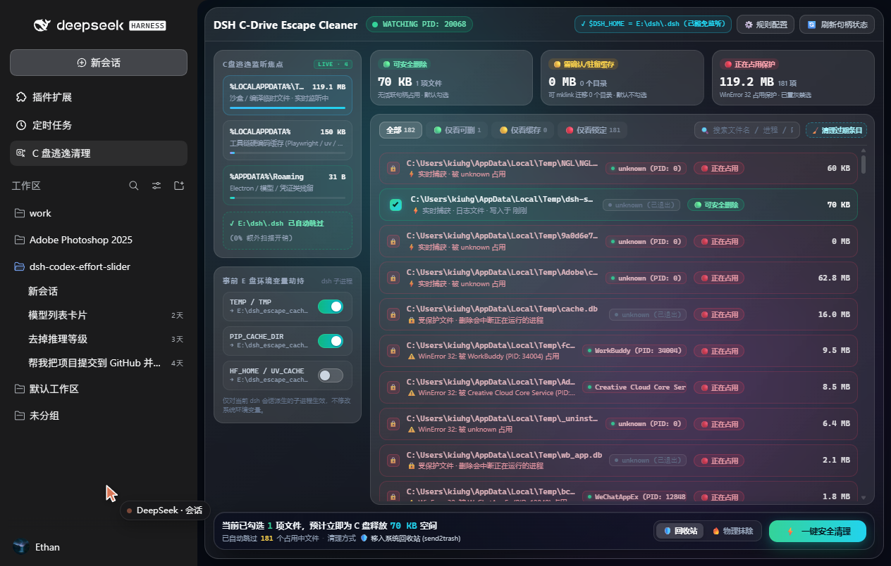

# dsh-c-cleaner

C 盘逃逸缓存清理插件 — a C-drive escape monitor and safe cleaner for DeepSeek Harness.

Implements `产品需求与技术规格文档 (PRD).md` as a **native Cordis host plugin** (Node.js, zero
runtime dependencies beyond Node built-ins).

| PRD | Module | Status |
| --- | --- | --- |
| 3.1 事前拦截 — environment hijack | `lib/env-hijack.js` | implemented, live-proof captured |
| 3.2 事中监控 — C-drive watcher | `lib/watcher.js`, `lib/process-tree.js` | implemented |
| 3.3 三级分类 — three-tier classification | `lib/classifier.js` | implemented |
| 3.4 事后清理 — safe cleaner | `lib/cleaner.js` | implemented |
| 3.4 目录迁移 — `mklink /J` junction migration | `lib/symlink-migrate.js` | implemented (Phase 3) |
| 4 CLI/TUI — `c-clean` command | `lib/commands.js` + `lib/web-api.js` + `client.js` | `status`, `now`, `ui`, `migrate`, `unmigrate` implemented |
| 5 持久化 — SQLite state | `lib/state-db.js` | implemented (`node:sqlite`) |
| 7 会话结束静默清理 — `post_session_close` | `lib/session-hook.js` | implemented (Phase 3, opt-in) |

Scope note: this is **Phase 1 + Phase 2 + Phase 3** of the PRD's milestone plan. Both Phase 3
deliverables are implemented:

- **`mklink /J` junction migration** (PRD §3.4/§7) — move a stubborn directory off C: wholesale,
  then leave a directory junction at the original path so programs that hardcode it keep working
  while their bytes land on the target volume. Undo is supported.
- **`post_session_close` silent clean** (PRD §7) — a session-close hook that quietly sweeps 🟢
  files. The host has no event by that name; the hook binds `session/disposed` (see *Phase 3*
  below). It is **off by default** (`sessionCloseClean: false`).

`ui` is delivered as a Harness sidebar panel (see *The interactive panel* below) rather than a
terminal TUI, because a Cordis slash command cannot render an interactive component.

## Install

`dsh plugin` is the official entry point: it is a pnpm front end that runs inside the profile
directory and, after a successful install, rewrites `dsh.profile.bundles` for every new dependency
that declares `dsh.bundle`. This package declares one (`./cordis.patch.yml`), so it becomes a live
profile layer automatically — never hand-edit the profile's `package.json` or `cordis.patch.yml`,
and never create packages under `$DSH_HOME`.

### From a workspace checkout (absolute path)

```sh
dsh plugin --profile <profile> add <abs path to this directory>
# e.g. dsh plugin --profile tauri add F:/work/dsh-c-cleaner
```

A relative directory works too, interpreted from the current working directory:

```sh
cd F:/work && dsh plugin --profile <profile> add ./dsh-c-cleaner
```

Both forms install a **link** dependency, so later edits in the checkout are visible on disk.

### From npm (by name)

```sh
dsh plugin --profile <profile> add dsh-c-cleaner
```

### From GitHub

```sh
dsh plugin --profile <profile> add github:wuyu1327083461/dsh-c-cleaner
```

### From a packed tarball

```sh
dsh plugin --profile <profile> add file:<abs path to dsh-c-cleaner-0.5.0.tgz>
```

Use a Windows-style path (`file:C:/...`), not an MSYS path (`file:/c/...`) — pnpm does not accept
the latter.

### Through the `plugin_manager` tool

The same install, driven from an agent session rather than a shell:

```
plugin_manager { action: "install_bundle", target: "<abs path to this directory>" }
```

Replacing an already-installed copy of this package requires a harness **restart** to load a fresh
JS module generation; a first-time install can activate via HMR.

### What `files` must contain

pnpm packs a git or tarball dependency according to the `files` array, so `cordis.patch.yml` **must**
be listed there. If it is missing, the installed tree has no patch file and the install is rejected
with `dsh: installation rejected: ... failed to read overlay ... cordis.patch.yml: ENOENT` and then
rolled back. Path and `link:` installs bypass packing and are unaffected, which is why the omission
can hide for a long time.

## Usage

```
c-clean status                      # read-only summary, no disk walk
c-clean ui                          # points at the interactive panel (Harness sidebar)
c-clean now                         # clean all 🟢 SAFE_TO_DELETE to the recycle bin
c-clean now --deep                  # also clean 🟡 CAUTION_CACHE
c-clean now --force                 # physical delete instead of the recycle bin
c-clean now --deep --force
c-clean migrate                     # list the stubborn directories worth moving off C:
c-clean migrate <dir>               # move it to E: and leave a directory junction (PRD 3.4, mklink /J)
c-clean unmigrate <dir>             # reverse a migration, moving the data back onto C:
```

`status` output, first line is the PRD §4 contract format:

```
🟢 可清理: 342.0 MB (128个文件) | 🟡 缓存驻留: 1.2 GB | 🔴 正在占用: 3个文件
环境变量劫持: ✅ 已生效 (9/9 变量) → E:\dsh_escape_cache
```

## The interactive panel (PRD §4 `ui`)

A slash command cannot render a component, so `c-clean ui` returns a pointer plus the live
headline, and the actual UI is a **Client-slot React panel** in the Harness sidebar. Look for the
**C 盘逃逸清理** icon in the sidebar rail:



The panel is a full-page `main`-slot component fed by a fenced JSON API on the Host half:

| Endpoint | Method | Returns |
| --- | --- | --- |
| `/c-cleaner/api/state` | GET | `{rows, hijack, escapeRoot, useRecycleBin, escapeWritable}` |
| `/c-cleaner/api/refresh` | POST | re-polls the process tree, then the **same** snapshot shape |
| `/c-cleaner/api/clean` | POST | `{report, rejected, rows}` |
| `/c-cleaner/api/stale` | GET | `{count, bytes, scanned, kept}` — how many tracked rows today's gate would reject |
| `/c-cleaner/api/purge` | POST | forgets those rows, then `{forgotten, bytes, remaining, rows}` |
| `/c-cleaner/api/migrate` | POST | `{path}` → moves it to E: and leaves a junction: `{result, migrated, rows, migrations}` |
| `/c-cleaner/api/unmigrate` | POST | `{path}` → reverses a recorded migration: `{result, migrated, rows, migrations}` |

`/state` and `/refresh` deliberately return an identical snapshot shape. Returning a
rows-only payload from `/refresh` made the header render "env hijack inactive" right after a
refresh — a false alarm about the escape root on the panel's most load-bearing status line.

### Forgetting pre-gate rows (`/stale` + `/purge`)

The PRD §3.2 noise gate (see *Known limitations* items 1–2 below) only applies to
writes the watcher sees **from now on**. Rows written before it existed — measured live:
**1079 of 2205 green rows, ~1.09 GB**, mostly Windows SDK installers and Visual Studio DLLs that
belong to other software — stayed in the table. They are not dangerous to delete: they are
unlocked files in `%TEMP%`. But 全选可清理项 / 清理全部可清理 act on **all** green rows, so one
click would have swept other software's installer payloads into the recycle bin, and they buried
the dsh-authored rows the PRD actually asks this panel to show.

「清理过期条目」 removes exactly those rows from the view. It is **bookkeeping only**:

- it reuses the *same* `classifyName()` the watcher uses, so there is one implementation of the
  admission rule, not two that can drift;
- only `SAFE_TO_DELETE` rows are eligible — a 🔴 or 🟡 row is never forgotten, whatever its name;
- the PRD §3.3 credential valve still applies (`credentials.json` survives), and
- **no file on disk is touched.** Proven live: after the purge removed the row for an 84 MB
  installer, the file was still on disk at its original size.

`GET /stale` only counts, so the panel can show the number before the user commits.

### Why the API is fenced

`/clean` **deletes files**, and `127.0.0.1:3080` is reachable from any page on the machine. So
every request must pass `isTrustedApiRequest()` (`lib/web-api.js`), which refuses a request
unless its `Host` is loopback (or in `trustedHosts`), refuses `sec-fetch-site: cross-site`
outright, and otherwise requires the `Origin` hostname to equal the `Host` hostname (with
`dsh-app://app`, the desktop shell's own origin, allowed explicitly). A foreign `Origin` on an
otherwise-loopback request is refused — proven live:

```
# live, against the running harness
curl -H 'Host: evil.example.com' http://127.0.0.1:3080/c-cleaner/api/state   -> 403
curl -X POST .../c-cleaner/api/clean  -d '{"paths":["C:\\Windows\\System32\\kernel32.dll"]}'
                                                                             -> rejected, deletedCount 0
```

The second one is the load-bearing guard: **the panel may only clean what the plugin already
tracked**. Every requested path is matched (case-insensitively) against the persisted rows, and
each record handed to the cleaner is rebuilt **from the persisted columns** — a client that
forges `{"category":"SAFE_TO_DELETE"}` for a 🔴 file cannot promote it. `test/_lead-phase2-api.mjs`
asserts exactly that with a forged body.

The panel's own transport uses the page's directory base rather than an origin-rooted path
(`hostRouteUrl` in `client.js`), because a leading-slash URL pins itself to the origin root and
404s behind a reverse-proxy directory. In the desktop shell the page is `dsh-app://app/` and the
shell's protocol handler forwards non-module paths to the Host same-origin.

### The glass panel (`/c-cleaner/ui`)

The React `main`-slot panel above is one of **two** renderings, and the second one is the one
worth looking at. `c-clean ui` also opens the **glass panel** at
`http://127.0.0.1:3080/c-cleaner/ui/index.html` — a self-contained document (2650 lines, zero
external requests, no CDN, no framework) served by the plugin itself:

| Endpoint | Method | Returns |
| --- | --- | --- |
| `/c-cleaner/ui/api/get_state` | POST | the full snapshot: env groups, watch roots, tier rows |
| `/c-cleaner/ui/api/clean` | POST | flat `{ok, cleaned, skipped, freed_bytes}` |
| `/c-cleaner/ui/api/migrate` | POST | `{ok, target, bytes_moved}` — junction to E: |
| `/c-cleaner/ui/api/unmigrate` | POST | reverses a recorded migration |
| `/c-cleaner/ui/api/poll_events` | POST | `{cursor, events}` — the ⚡ 实时捕获 live channel |

It is served as-is instead of being rewritten as React components, because a 2500-line
already-verified interface ported by hand is guaranteed visual drift. `lib/panel-ui.js` registers
the route on a **second prefix** (`/c-cleaner/ui`, longest-prefix-wins over the existing
`/c-cleaner/api`) and translates its flat dialect into this plugin's own `{ok, value}` envelope
and category names — the document itself needed no edit, since its `REST_BASE='api/'` is a
relative path the browser resolves against the document's own directory.

Two panel-specific behaviours are deliberate and load-bearing
(`lib/panel-snapshot.js`):

1. **CAUTION rows aggregate one directory each.** `findCandidates` groups by `path.dirname`, which
   turns `uv-cache/wheels/<1000 .whl>` into 1000 rows that each refuse to migrate. The panel groups
   by *the first directory under a watch root* instead, so one 🟡 row == one migratable directory.
2. **Paths are printed in their C: spelling, never resolved through a junction.** A migrated
   directory is a reparse point on C: pointing at E:; `realpath` would print the E: path and
   destroy the one fact the row exists to convey — "already tunneled, but still occupying its C:
   slot".

The live channel is a bounded ring buffer (`LIVE_BUFFER_MAX = 500`, `index.js`), not an unbounded
log: the panel only ever asks for events **newer** than its last cursor, and a long-idle session
must not grow it without limit. Rows are pushed to the buffer *before* any `autoClean` can remove
the file, so the panel shows the capture even when the file is gone a moment later.

## How the env hijack actually works (the load-bearing detail)

The PRD's premise is "`$DSH_HOME` already moved to E:, so only C-drive *escape* writes remain".
Module 3.1 is what stops new ones.

There are two ways to feed a child process an environment variable in this harness, and only one
of them can carry `TEMP`/`PIP_CACHE_DIR`:

- `ctx.shellEnv.register()` contributes **`DSH_*`-namespaced** keys only
  (`dsh-subprocess/lib/index.js:13` → `const DSH_ENV_PREFIX = "DSH_"`). It cannot carry `TEMP`.
- Mutating `process.env` works, because every harness child is spawned from a **live** read of the
  parent environment: `dsh-subprocess/lib/index.js:50-56` `scrubbedParentEnv()` builds the child
  env from `Object.entries(process.env)`, filtering only names matching `/KEY|PASSWORD|SECRET|TOKEN/i`
  and names starting with `DSH_`.

So the plugin mutates `process.env` and nothing else. Verified against the real installed
`scrubbedParentEnv`, with negative controls:

```
=== scrubbedParentEnv() AFTER hijack (what every harness child inherits) ===
  PASS  TEMP                     = E:\dsh_escape_cache\temp
  PASS  PIP_CACHE_DIR            = E:\dsh_escape_cache\pip_cache_dir
  ... 9/9 hijacked variables survive the harness env scrub
--- negative control (proves the scrub is live) ---
  MY_FAKE_API_KEY present       : false (expect false — matches KEY)
  DSH_SHOULD_BE_STRIPPED present: false (expect false — DSH_ prefix)
--- end-to-end: real child process ---
  child cmd.exe saw TEMP = E:\dsh_escape_cache\temp
```

Reproduce with `node test/_env-propagation.mjs`.

Variables redirected (`lib/config.js` → `DEFAULT_ENV_MAP`): `TEMP`, `TMP`, `TMPDIR` → `temp`;
`PIP_CACHE_DIR` → `pip`; `UV_CACHE_DIR` → `uv`; `HF_HOME` → `huggingface`; `TORCH_HOME` → `torch`;
`NPM_CONFIG_CACHE` → `npm`; `PLAYWRIGHT_BROWSERS_PATH` → `playwright` — all under `escapeRoot`,
which is derived from the **drive of `$DSH_HOME`** (`path.parse(dshHome).root`), so with
`DSH_HOME=E:\dsh\.dsh` the escape root is `E:\dsh_escape_cache`. Nothing is hardcoded to `E:`.

Two deliberate properties:

- **The OS environment is never touched.** Only this process's `process.env` is mutated; nothing is
  written to the registry or to a user/system-wide environment block.
- **`restore()` puts back exactly what was there.** A variable that did not previously exist is
  *deleted* on restore, not set to the string `"undefined"`. The prior value is captured, never
  hardcoded. `SCRUB_PATTERN` (`/KEY|PASSWORD|SECRET|TOKEN/i`) is checked before assigning, so a
  user who adds e.g. `MY_API_KEY` to `envMap` gets it skipped with a reason instead of a credential
  silently relocated.

## Three-tier classification (PRD 3.3)

| Tier | Condition | Default |
| --- | --- | --- |
| 🟢 `SAFE_TO_DELETE` | not locked **and** (in a Temp dir **or** suffix `.tmp`/`.log`/`.pyc`/`.bak` **or** known one-time unzip cache) | checked |
| 🟡 `CAUTION_CACHE` | not locked **and** AppData toolchain cache / model weights / browser kernel / precompiled pkg | unchecked |
| 🔴 `LOCKED_CRITICAL` | locked (WinError 32 / `PermissionError`) **or** a persistence-shaped name (`.lock`, `.sqlite`, `.db`, `auth`, `config`, `token`) | locked, non-selectable |

The conditions are AND-ed. Lock detection probes whether the file can actually be **deleted**
(`fs.renameSync(path, path)` → `EBUSY`/`EPERM` means locked; `ENOENT` means not locked). A
self-rename needs exactly the delete permission, which is the operation that matters.
`openSync(path,'r+')` was the Phase 1 probe and measurement proved it wrong: a process can
hold a file open with read+write sharing but WITHOUT delete sharing, so `r+` succeeds on
files that cannot be deleted (see `CONTRACTS.md` §8.1).

For a 🔴 file, **who holds it** is then resolved out-of-band through the Windows Restart Manager
(`lib/lock-owner.js`), which yields a real holder PID and process name; that name is what gets
displayed alongside the PID. This is asynchronous and cached, because a synchronous
`classify()` cannot block on a ~140 ms PowerShell round trip. See limitation 2 below.

## Safety properties

These are the properties that make automatic deletion defensible, and each is backed by a test:

1. **Hardcoded protected-path blacklist** (PRD 6.2) — `C:\Windows`, `C:\Program Files*`,
   Desktop, Documents. `clean()` applies its **own** veto, independent of what `classify()`
   returned, so a classification bug cannot widen the delete set. Demonstrated: a file under
   `C:\Windows\Temp` classified `SAFE_TO_DELETE` is still refused by `clean()` with reason
   `protected path (PRD 6.2 hardcoded blacklist) — refused`.
2. **Instant re-validation** — lock state is re-checked immediately before each unlink. A file that
   becomes locked between classification and deletion is skipped, not deleted.
3. **`clean()` never throws** — a vanished file, a locked file, an empty record set, or a
   `PermissionError` mid-run all resolve to a report entry; the run continues (PRD 6.3).
4. **Recycle bin by default** — deletion goes through
   `Microsoft.VisualBasic.FileIO.FileSystem.DeleteFile(..., RecycleOption.SendToRecycleBin)`,
   batched ≤50 paths per invocation. `--force` / `useRecycleBin: false` opts into physical removal.
5. **No recursive C: scan** (PRD 6.1) — `fs.watch({recursive:true})` is permitted **only** under
   `%LOCALAPPDATA%\Temp`. The watcher refuses recursion on drive roots, `%USERPROFILE%`,
   `C:\Users`, `C:\Windows*`, `C:\Program Files*`, `C:\ProgramData`, and reports the refusal in
   `stats().recursiveForcedOff`.

## Configuration

Every field is optional; all have defaults. Set them in the bundle row's `config`:

```yaml
- insert:
    - id: dsh-c-cleaner
      name: 'dsh-c-cleaner'
      config:
        debounceMs: 3000
        useRecycleBin: true
```

| Key | Default | Meaning |
| --- | --- | --- |
| `enabled` | `true` | master switch |
| `dshHome` | `$DSH_HOME` | escape root drive is derived from this |
| `escapeRoot` | `<dshHome drive>:\dsh_escape_cache` | hijack destination |
| `stateDir` | `$DSH_HOME/plugins/c_cleaner` | state directory |
| `dbPath` | `<stateDir>/state.db` | SQLite file |
| `envMap` | see above | variable → subdirectory |
| `watchDirs` | `%LOCALAPPDATA%\Temp` (recursive), AppData Local + Roaming (depth 1) | monitored roots |
| `protectRoots` | `C:\Windows`, `C:\Program Files*`, Desktop, Documents | never deleted |
| `excludeNames` | `[".dsh"]` | path segments excluded (`.dsh` itself is never monitored) |
| `aiSignatureGlobs` | AI toolchain name patterns | session-window attribution |
| `debounceMs` | `3000` | coalesce streaming writes |
| `pollIntervalMs` | `5000` | process-tree poll |
| `sessionWindowMs` | `1800000` | session window |
| `useRecycleBin` | `true` | recycle bin vs physical delete |
| `maxBatch` | `50` | paths per recycle-bin invocation |
| `resolveLockOwner` | `true` | resolve a 🔴 file's holder PID via the Windows Restart Manager (PRD 3.3) |
| `noiseGate` | `'enforce'` | PRD §3.2 admission: `enforce` drops non-admitted files, `audit` counts but still records, `off` is the Phase 1 passthrough |
| `admitCriticalNames` | `true` | the §3.3 safety valve: a credential-shaped basename is never noise-filtered |
| `handleIndex` | `false` | ⚠️ psutil handle→PID index (rule #1). Measured ~2 s CPU/sweep — see limitation 1 |
| `handleSweepMs` | `60000` | handle-index sweep interval (min 15000) |
| `pythonPath` | `null` | python interpreter for the handle index; `null` resolves `python` from PATH |
| `recoverClientGraph` | `true` | rebuild the stale `dsh.client` cache entry so the panel loads without a restart |
| `autoClean` | `false` | **deprecated in Phase 3** — per-event auto-clean of 🟢 rows as the watcher sees them. Superseded by `sessionCloseClean`; kept for compatibility |
| `sessionCloseClean` | `false` | ⚠️ PRD Phase 3 `post_session_close`: silently clean 🟢 rows when a session closes |
| `sessionCloseMinAgeMs` | `60000` | a session younger than this is not swept (the host disposes throwaway sessions constantly) |
| `migrateTargetRoot` | `null` | junction-migration destination; `null` derives `<escapeRoot>\migrated` |
| `migrateVerify` | `true` | re-measure both trees after a cross-volume copy before deleting the source |
| `migrateMinBytes` | `10485760` | a directory below this total is not offered for migration |

Config is validated by a **hand-rolled Standard Schema** (`lib/config-schema.js`). Cordis only
requires `{ '~standard': { version, vendor, validate } }`
(`cordis/lib/index.js:956-962`), and implementing it directly avoids statically importing
`schemastery`, which resolves from `$DSH_PROFILE_DIR/node_modules` — a plugin that fails that
resolution fails to load *entirely*, which is too high a price for an optional convenience.

## Layout

```
index.js                  plugin entry: apply(ctx, config), wiring + teardown
lib/config.js             resolveConfig, DEFAULT_ENV_MAP, formatBytes
lib/config-schema.js      Standard Schema `Config`
lib/env-hijack.js         EnvHijacker: install / status / restore
lib/process-tree.js       ProcessTree: dsh child-PID set via Win32_Process
lib/watcher.js            CWatcher: fs.watch + debounce + AI-signature filter
lib/classifier.js         isLocked / isProtectedPath / classify
lib/cleaner.js            toRecycleBin / hardDelete / clean (never throws)
lib/lock-owner.js         LockOwnerResolver: Restart Manager → holder PID + name (PRD 3.3)
lib/state-db.js           StateDB over node:sqlite (+ migrations journal)
lib/symlink-migrate.js    Phase 3: inspectDirectory / migrateDirectory / undoMigration / junction
lib/session-hook.js       Phase 3: post_session_close -> `session/disposed` silent clean
lib/commands.js           registerCommands: c-clean status|ui|now|migrate|unmigrate
lib/panel-snapshot.js     tracked_files rows -> the panel's TrackedFileItem[] (CAUTION dir aggregation)
lib/panel-ui.js           serves ui/index.html at /c-cleaner/ui and adapts its REST dialect
ui/index.html             the glass panel document (self-contained, no external requests)
test/run.js               dependency-free acceptance + adversarial harness
test/_env-propagation.mjs proves the hijack reaches real children
CONTRACTS.md              frozen interface contract the modules were built against
CONTRACTS-PHASE2.md       Phase 2 frozen contract (noise gate + handle index)
CONTRACTS-PHASE3.md       Phase 3 frozen contract (junction migration + session-close hook)
```

## Known limitations

Stated plainly, because each one bounds what this plugin can promise:

1. **`ProcessTree.ownerOf()` returns `null` unless the handle index is enabled.** Node exposes no cheap
   handle→PID mapping on Windows, so PRD §3.2 rule #1 is served by `lib/handle-index.js`, an **opt-in**
   psutil-backed index. It is off by default because a handle sweep over an 11-member tree measures
   **~2.0 s of CPU** (psutil's `open_files()` re-walks the system handle table per process), which on
   a 60 s interval is already ≈3.4 % of one core — over the PRD's own ≤2 % marginal-CPU budget (PRD
   §6.1). It never fabricates a PID, caches each sweep, and auto-disables if sweeps run over budget.
   Practical consequence with the default `handleIndex: false`: **rule #2 (session window + AI-toolchain
   signature) is what populates candidates**, plus the §3.3 credential valve below.
2. **The noise gate adds a deliberate PRD §3.3 safety valve.** PRD §3.2 says to record only
   dsh-attributable or AI-signature files — but PRD §3.3 requires a credential-shaped file in `%TEMP%`
   to surface as 🔴 `LOCKED_CRITICAL` with its holder. A `credentials.json` matches no AI-toolchain
   signature, so a strict signature gate would silently noise-filter away exactly what §3.3 orders us
   to show. `admitCriticalNames` (default `true`) therefore always admits a basename matching
   `\.lock$|\.sqlite3?$|\.db$|auth|config|token|credential`. Verified live in the same directory and
   second: `Win11SDK_*.msi` → filtered; `pip-*.log` → 🟢 tracked; `credentials.json` → 🔴 tracked.
   Set `noiseGate: audit` to count without dropping, or `off` for the legacy passthrough.
3. **Who holds a locked file is resolved by a different route: the Windows Restart Manager**
   (`lib/lock-owner.js`, PRD §3.3). `classify()` is synchronous and cannot wait ~140 ms for a
   PowerShell round trip, so `locked_by_pid` is filled in *after* the row is persisted and patched
   back in. Because PRD §5's DDL is fixed and has no holder-name column, the holding process name
   rides in `source_process`, and only when nothing better already claimed that column. Batched
   (one spawn per 250 ms window), cached (30 s for a hit, 5 s for a miss), and reached only for rows
   that are genuinely locked — a rare event — so the PRD §6.1 budget is untouched by construction.
   Set `resolveLockOwner: false` to disable. Practical consequence: `source_process` for a
   *non-locked* file stays `null`; only 🔴 rows acquire a holder name.
4. **Attribution is best-effort**, so a foreign process writing to `%TEMP%` during a dsh session can
   be mis-attributed. `%TEMP%` is a shared directory; the AI-signature filter narrows this but does
   not eliminate it. This is why the default action is recycle-bin deletion of 🟢 items only.

   **Measured honestly, the residual is large.** Rule #2 is a *name-shape* heuristic, and the PRD's
   own illustrative signature list (`tmp*`, `*.log`, `*.tmp`, `*.pyc`, …) is weak on Windows, where
   those shapes are what the OS and other vendors emit constantly. Bucketing the tracked set by
   whether a pattern names an AI toolchain at all (`test/_lead-p2-noise-composition.mjs`):

   | Bucket | Rows | Share |
   | --- | --- | --- |
   | A — toolchain-specific (`pip-*`, `torch*`, `hf-*`, `node-*`, `*-cache`) | 431 | 24.2 % |
   | B — generic extension only (`*.tmp`, `*.log`, …) | 778 | 43.7 % |
   | C — PRD §3.3 credential valve | 539 | 30.3 % |
   | D — no signature at all (pre-gate stragglers) | 32 | 1.8 % |

   Real examples in bucket B are *other software's* files: BITS `BIT450E.tmp` (Edge),
   `dd_BackgroundDownload_*.log`, Adobe `dunamis-*.log`, Visual Studio `tmp.edb`. So the gate
   reliably removes large binary shapes (`.msi`, `.dll`, `.exe` — the stuff that actually fills the
   drive) but does **not** reduce `%TEMP%` churn to dsh-authored files only. Closing that gap
   properly needs rule #1 (handle reverse-lookup), which the §6.1 CPU budget pushes to opt-in
   (`handleIndex`), or an `aiSignatureGlobs` narrowed to toolchain-specific patterns — e.g. dropping
   `tmp*`/`*.log` — which trades recall for precision and is a one-line config change.
5. **Protection is canonicalized, but no normalization is perfect.** `isProtectedPath()` now resolves
   `\\?\`/`\\.\` device prefixes, UNC and admin-share spellings, repeated separators, trailing
   dots/spaces per path segment, 8.3 short names (`C:\PROGRA~1`), junctions/reparse points, and a
   case-insensitive comparison — and the delete-time check re-resolves *fresh* rather than trusting
   the classify-time cache. This closed four real PRD §6.2 bypasses found by adversarial testing
   (see `test/run.js` probes A1/A6/A9/A10). It is still a denylist of known-good normalizations, not
   a proof; a filesystem form nobody has thought of yet is not covered.
6. **`ui` (PRD §4) is delivered as a Harness panel, not a terminal TUI.** The PRD asked for a
   Textual-style terminal panel with hotkeys; a Cordis slash command cannot render an interactive
   component, so the panel is a Client-slot React page in the Harness sidebar and `c-clean ui`
   returns a pointer to it. The PRD's hotkeys are honoured inside the panel (`Space` toggle, `Enter`
   clean selected, `M` migrate the selected folder to E:, `R` refresh).
7. **Migration is a move, not a copy — and the PRD's `mklink /J` is done without a shell.** The
   PRD names `mklink /J`; invoking it means spawning `cmd.exe` with a user-controlled quoted path,
   the classic injection surface. `fs.symlinkSync(target, link, 'junction')` produces the *same*
   NTFS junction with no shell and no admin rights (pinned by probe `P3`). Cross-volume
   `fs.renameSync` is impossible on Windows (measured `EXDEV`), so the move is
   `cpSync` → independent re-measure of both trees → `rmSync` of the source; an accounting mismatch
   deletes the partial copy and leaves the source untouched. A journal row makes an interrupted
   migration recoverable rather than lossy. A file held open inside the directory is refused up
   front: `inspectDirectory` probes every file and answers `FILES_IN_USE` (naming the holders)
   *before* anything is copied, because `rmSync` cannot remove a file held without delete sharing
   and would delete the ones it could reach first. Close the holding program and retry.
8. **Phase 3's `post_session_close` is a name, not an event.** No such identifier exists anywhere
   in `@deepseek-ai/*`; the real seam is Cordis **`session/disposed`**
   (`@deepseek-ai/dsh-session/lib/index.js:1813-1821`, reached from `detachEntered` at line 1780),
   the same event `dsh-session-telemetry`, `dsh-session-persistence-jsonl` and
   `dsh-session-projection-cache` subscribe to. The hook keeps the PRD name in its config key so the
   requirement stays traceable. It is a *scheduler in front of `clean()`*, not a second delete path:
   every §6.2 / directory / reparse refusal still applies at delete time.
9. **The panel is discovered from the manifest at process start.** `@deepseek-ai/dsh-client-modules`
   (`lib/index.js:510,703,707,715,729` — `grep -n pkgMeta` finds no delete), so a plugin that gains a
   Client half *after* the harness started would stay out of the browser boot graph until a restart.
   `lib/client-graph.js` rebuilds that one cache entry in-process from the on-disk manifest and asks
   the registry to reprocess our own loader row, which is why the panel appears without a restart.
   It is feature-detected and no-ops on any doubt; set `recoverClientGraph: false` to disable.
10. **The plugin only redirects variables it knows about.** A toolchain that honors none of the nine
   variables (or hardcodes a C: path) still escapes; that residue is exactly what Modules 3.2–3.4
   exist to catch.
11. **A watcher armed by a module generation that predates the raw-handle registry cannot be reaped
    in-process — restart the harness.** Editing `lib/` under a live harness hot-reloads the module
    (the HMR layer watches this directory as a module root), but Cordis does not always dispose the
    superseded generation before the new one starts. Measured on this host with module-init/`start()`
    markers: `START live=1 … START live=2` with **zero paired `STOP`**, i.e. two watcher generations
    coexisted, and the older one kept writing rows under the *old* gate rules. Three guards now make
    `apply()` re-entrant-safe: a process-global `Symbol.for('dsh-c-cleaner.active-generation')`
    slot holding the previous disposer (a module-scope binding cannot work, because HMR re-imports the
    module body and each generation gets a fresh empty variable); a
    `Symbol.for('dsh-c-cleaner.live-watchers')` registry of live `CWatcher`s that a new
    generation force-stops; and a `Symbol.for('dsh-c-cleaner.raw-watchers')` registry of the
    **raw `fs.FSWatcher` handles**, which a new generation closes directly. The raw registry is the
    one that actually cures the leak: `_getActiveHandles()` returns `[]` and
    `getActiveResourcesInfo()` names no `FSEventWrap` for the plugin's own watch options
    (`{recursive:false, persistent:false}` + `unref()`), so a handle nobody registered is
    undiscoverable — measured with a leaked watcher that still delivered (`delivered after
    scan-close: 2`) after a full handle scan. **Consequence:** a generation that leaked a handle
    *before* the raw registry existed cannot be reached by any of the three guards, so its rows keep
    appearing until the harness restarts. Its damage is bounded: `test/_lead-p2-gate-residue.mjs`
    classifies every persisted row against the shipped gate and reports **0 deletable rows
    gate-rejected** (all residue is in the greyed 🔴/🟡 tiers, which are never deleted), so this is
    an accuracy defect, never a deletion hazard.
12. **A route registered by a module generation that predates the claim slot must be reclaimed by
    path, because the harness route table only deletes by path.** Measured live: after an HMR reload
    the panel answered `500 {"code":"internal","message":"database is not open"}` for *every* verb.
    Cause: an earlier generation still owned `/c-cleaner/api`, so the new generation's
    `webServer.register` threw `webserver: duplicate prefix route "/c-cleaner/api"`, the throw was
    swallowed, and every request kept reaching the **dead** generation's handler whose captured
    `StateDB` had already been closed by its own teardown. Two guards fix it. (a) The route disposer
    is parked in a process-global `Symbol.for('dsh-c-cleaner.web-api-route')` claim slot, and
    every dispose is **ownership-checked** — `register` returns `() => table.delete(route.path)`,
    which deletes by **path, not identity**, so an unconditional dispose in a superseded generation's
    teardown would delete the *new* generation's route and re-create the 404. (b) `registerWebApi`
    reclaims its own prefix directly from the service's prefix table (`WebServer.prefixes`, a plain
    `Map`) before registering, which is what actually cures a phantom that predates the slot. Only
    this plugin's own path is ever removed. Probe: `test/_lead-p2-coldboot-route.mjs` plants a
    phantom handler and asserts the live generation replaces it and answers 200 (mutation-proven by
    `test/_lead-p2-coldboot-route-mutation.mjs`, 4 mutations).

## Verification

```
node test/run.js                 # acceptance + adversarial harness (the regression floor)
node test/_env-propagation.mjs   # proves the hijack reaches real child processes
node test/_wire.mjs              # apply() wiring + teardown against a mock ctx
node test/_perf-cpu.mjs          # PRD 6.1 CPU, isolated from harness I/O
node test/_perf.mjs              # PRD 6.1 RSS + the recursion guard

# Phase 2
node test/_lead-phase2-api.mjs      # API fence, path/category forgery refusal, ui verb grammar
node test/_lead-phase2-client.mjs   # client half: slots, tiers, locale disposal, no HTML injection
node test/_lead-p2-config.mjs       # the new config keys + fail-closed protection
node test/_lead-p2-purge.mjs        # /stale + /purge: forget only what the gate rejects today
node test/_dev-noise-gate.mjs       # the PRD 3.2 admission decision, all three modes
node test/_lead-p2-regex-design.mjs # the tier/gate predicate split, incl. a fuzz for TIGHT ⊆ LOOSE
node test/_lead-p2-valve-fix.mjs    # the §3.3 valve admits credentials, rejects installers
node test/_lead-p2-reentry.mjs      # apply() is re-entrant-safe across HMR generations
node test/_lead-p2-reentry-mutation.mjs  # ...and that probe is mutation-proven
node test/_lead-p2-phantom-reap.mjs # a leaked raw handle is reachable and closable
node test/_lead-p2-gate-residue.mjs # read-only: no deletable row is gate-rejected
node test/_lead-p2-adversarial-final.mjs           # the final round: predicate split, raw registry, env-restore race
node test/_lead-p2-adversarial-final-mutation.mjs  # ...and that probe is mutation-proven (4 mutations)
node test/_lead-p2-coldboot-route.mjs              # cold boot + phantom route reclaim (the measured 500)
node test/_lead-p2-coldboot-route-mutation.mjs     # ...and that probe is mutation-proven (4 mutations)
python test/_lead-p2-e2e-clean.py "<windows path>"   # drives the LIVE panel API end to end
python test/_lead-p2-valve-live.py                   # the PRD 3.3 valve, live, same second as noise
python test/_lead-p2-tree-probe.py  <pid> 3          # psutil tree + handle-sweep cost

# Phase 3
node test/_lead-p3-db.mjs            # migrations journal: idempotent migrate, PENDING→MOVED→LINKED, supersede
node test/_lead-p3-migrate-live.mjs  # LIVE C:→E: migration + undo, through the real filesystem
node test/_lead-p3-refusals.mjs      # the migration gate: 21 refusal codes, protection decided before I/O
node test/_lead-p3-session-hook.mjs  # the session-close hook: arming, min-age, cooldown, error containment
node test/_lead-p3-grammar.mjs       # `migrate` / `unmigrate` argument grammar
node test/_lead-p3-locale.mjs        # both dicts cover every key the panel renders (incl. `[M]`)
node test/_lead-p3-verbs-live.mjs    # `migrate`/`unmigrate` verbs, live, incl. C:\Windows refused
node test/_lead-p3-api-live.mjs      # the /migrate + /unmigrate routes over real HTTP, fence included
node test/_lead-p3-busy-refusal.mjs  # a directory held open is refused before any copy, data intact
node test/_lead-p3-clean-e2e.mjs     # POST /clean end to end: files really deleted, dead rows dropped
node test/_lead-p3-user-report.mjs   # reproduces the reported EPERM directory; now a named refusal
python test/_lead-p2-cpu.py         <pid> 3          # the same sweep, CPU vs wall (the §6.1 number)

# the independent verifier's adversarial round
node test/adversarial-p2-api.mjs
node test/adversarial-p2-client.mjs
node test/adversarial-p2-gate.mjs
node test/adversarial-p2-purge.mjs
node test/adversarial-p2-purge-strict.mjs
node test/adversarial-p2-purge-rule1.mjs
node test/adversarial-p2-stalecount.mjs
node test/adversarial-p2-handle.mjs   # spawns real psutil sweeps: >120 s
```

### Live proof, captured on this host

Installed via `plugin_manager { action: "install_bundle", target: "F:\\work\\dsh-c-cleaner" }`
→ `{"changed":true,"application":"applied","warnings":[]}`.

**(a) The hijack reaches real children.** A plain harness `bash` call after installation:

```
$ node -e "console.log(process.env.TEMP, '|', process.env.PIP_CACHE_DIR)"
E:\dsh_escape_cache\temp | E:\dsh_escape_cache\pip

$ cmd //c "echo TEMP=%TEMP%"
TEMP=E:\dsh_escape_cache\temp
```

Git Bash prints `/tmp` for `$TEMP`, which looks like a failure but is not: MSYS *aliases* `/tmp`
to `$TEMP`, and `cd /tmp && pwd -W` reports `E:/dsh_escape_cache/temp`. The native `cmd` and the
native `node` runtime both confirm the redirected value. `E:\dsh_escape_cache\` now contains
`temp/ pip/ uv/ huggingface/ torch/ npm/ playwright/`.

**(b) The watcher records real C: writes into SQLite.** Writing one file into the *real*
C-drive `%TEMP%` (`C:\Users\kiuhg\AppData\Local\Temp\lead-live-proof-1837.tmp`) and waiting out
the debounce produced, in the live `state.db`:

```
{"file_path":"C:\\Users\\kiuhg\\AppData\\Local\\Temp\\lead-live-proof-1837.tmp",
 "category":"SAFE_TO_DELETE","file_size":10,"is_locked":0}
```

**(c) The schema is the PRD §5 schema**, created by the running plugin at
`E:\dsh\.dsh\plugins\c_cleaner\state.db`: `CREATE TABLE tracked_files (...)` with all nine PRD
columns, plus `idx_tracked_files_category` and `idx_tracked_files_checked`. The only deviation is
`CREATE TABLE IF NOT EXISTS`, required for `migrate()` idempotency.

**(d) PRD §6.1 is met.** Running the identical 10-second, ~92-file churn workload twice — once
with no watcher, once with the watcher attached — gives the plugin's marginal cost:

```
baseline : 10028ms, cpu 63.0ms => 0.63%
watcher  : 10025ms, cpu 156.0ms => 1.56%
PLUGIN MARGINAL CPU : 93.0ms over 10025ms = 0.93 %   (PRD <= 2%) -> PASS
RSS delta (plugin)  : 2.7 MB                          (PRD <= 30MB) -> PASS
```

The naive measurement (whole process, including the harness's own `fs.writeFileSync` calls)
reads 2.65% and would look like a failure; the plugin's own share is 0.93%. The recursion guard
also refuses `recursive:true` on `C:\` and `C:\Users\kiuhg` — `recursiveForcedOff: 2`.

### Live-plugin caveat for the test harness

Once the plugin is installed it is *running in the harness process*, so its hijack is already
applied before any test starts. A test that asserts `process.env.TEMP !== <ambient prior>` will
therefore fail spuriously. Set a sentinel value for `TEMP`/`TMP`/`TMPDIR` *before* constructing
the hijacker to test the real property independently of installation state.

Relatedly, `os.tmpdir()` returns the **hijacked** escape root once the plugin is live. A test that
creates its fixture directory with `os.tmpdir()` is writing into a `protectRoot`, where the watcher
correctly refuses to emit — so such a test measures the protection, not the watcher. Fixtures that
are meant to be *observed* must be created under the real C: `%TEMP%`.

### Editing the plugin while the harness is running

The installed package is a **symlink** to this working directory
(`$DSH_PROFILE_DIR/node_modules/dsh-c-cleaner -> F:/work/dsh-c-cleaner`), so an edit is
immediately visible on disk — but the running harness keeps the module generation it already
imported. Verified on this host, not assumed: with a file held under a real `FileShare.None` handle
(positive control: `openSync(p,'r+')` threw `EBUSY`), the live watcher persisted the row as
`LOCKED_CRITICAL` with `is_locked=1` and yet left `locked_by_pid`/`source_process` **null** — i.e.
the running process was still executing the pre-change `index.js`, which did not yet wire
`LockOwnerResolver`. The same file against the current modules resolves the holder.

The harness ships HMR with **module roots empty** (`@deepseek-ai/dsh-hmr`, `config.root: []` in
`@deepseek-ai/dsh-base/cordis.patch.yml`) — profile *configuration* hot-reloads, module *code* does
not. So: **restart the harness after editing `lib/` or `index.js`** for the change to take effect in
the live process. A fresh first-time install can still activate via HMR because there is no stale
generation to replace.
